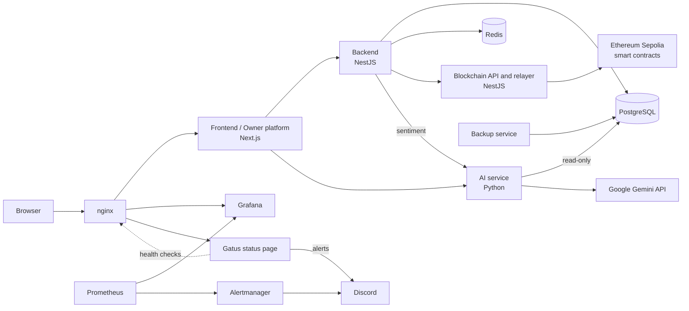
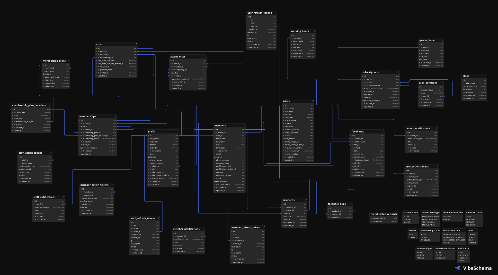

*This project has been created as part of the 42 curriculum by oboussel, mdahani, mait-all, ael-jama, obarais.*

<p align="center">
  
</p>

# Sportium

## Table of Contents

- [Description](#description)
  - [Key features](#key-features)
- [Instructions](#instructions)
  - [Prerequisites](#prerequisites)
  - [Setup and run](#setup-and-run)
  - [Access](#access)
  - [Backup and restore](#backup-and-restore)
- [Team Information](#team-information)
- [Project Management](#project-management)
- [Technical Stack](#technical-stack)
  - [Infrastructure and DevOps](#infrastructure-and-devops)
  - [Blockchain marketplace](#blockchain-marketplace)
  - [Design principles and security practices](#design-principles-and-security-practices)
- [Architecture](#architecture)
- [Project Structure](#project-structure)
- [Database Schema](#database-schema)
- [Features List](#features-list)
- [Modules](#modules)
- [Individual Contributions](#individual-contributions)
- [Resources](#resources)
  - [Documentation](#documentation)
  - [How AI was used](#how-ai-was-used)

## Description

**Sportium** is a multi-tenant SaaS platform for managing sports clubs, including gyms, swimming clubs, and other sports organizations.

Each club manages its own members, staff, memberships, schedules, and payments through dedicated Admin, Staff, and Member portals. A separate Owner platform manages the SaaS platform, its plans, and club subscriptions.

**Goal:** bring daily club operations into one system, supported by activity dashboards, an AI assistant, and a blockchain rewards marketplace for members.

### Key Features

- **Role-based access:** four roles with dedicated permissions and interfaces — Owner (SaaS operator), Admin (club administrator), Staff, and Member.
- **Club management:** manage members, staff, membership plans, duration options, and membership history.
- **Visits and attendance:** visit booking, QR-code check-in, and attendance tracking.
- **Schedules:** regular weekly working hours and special schedules for specific dates or date ranges.
- **Payments:** record member payments and view payment history.
- **Notifications:** in-app notifications, including membership and subscription expiry reminders.
- **Search and filtering:** searchable lists with filters, sorting, and pagination.
- **Dashboards:** statistics and visualizations for monitoring club activity.
- **Member feedback:** ratings, likes, feedback resolution, and sentiment analysis.
- **AI assistant:** admins, staff, and members ask questions about their club in plain language (English, French, Arabic, or Darija) and get answers from the club's data and documents, limited to what their role may see.
- **Blockchain rewards marketplace:** members earn **G** tokens when purchasing or renewing club memberships and spend them on marketplace products. The integration runs on the Ethereum Sepolia testnet and supports gasless transactions for members.
- **Localization:** multiple languages with right-to-left layout support.
- **Operations:** monitoring, a status page, and automated database backups.

## Instructions

### Prerequisites

- Docker **28.5.2** (with Docker Compose v2)
- `make`
- Free ports 8080 and 8443 on your machine

### Setup and run

1. Clone the repository and go to its root.
2. Prepare the environment files:
   ```bash
   ./setup-env.sh
   ```
   **You must run this script manually before `make up`.** Each service has its own `.env`. The script does three things:
   - **Creates** each service's `.env` from its `.env.example` when the `.env` does not exist yet.
   - **Generates secrets** (JWT secrets, cookie secret, database, Redis, and Grafana passwords, internal API keys) with random values, only where the value is empty.
   - **Checks the values you must provide yourself.** It stops with an error and lists the required values that are still empty (for example the Gemini API Key, owner password, the Discord webhook URL, and the blockchain private keys). It only warns about optional values (for example the email, and Cloudinary credentials), because the related features simply stay disabled until they are set.

   The script never overwrites a value that is already set and does not add missing variables to an existing `.env`. It is safe to run again at any time. Even after the script has run, you are free to edit any value in the `.env` files. After pulling updates, compare your `.env` files with the `.env.example` files for new variables. Values shared between services (such as the database credentials) are defined once in `devops/.env`, and the connection URLs are built from them in `docker-compose.yml`.
3. Start everything:
   ```bash
   make up
   ```
4. Run `make` with no arguments to list all available commands.

### Access

| Service | URL |
|---|---|
| Application | https://localhost:8443 |
| Owner platform | https://localhost:8443/owner-portal |
| Grafana (dashboards) | https://localhost:8443/grafana |
| Status page (Gatus) | https://status.localhost:8443 |

The TLS certificate is self-signed and generated automatically when the nginx image is built, so your browser will show a warning the first time. Accept it to continue. `status.localhost` resolves to your machine automatically on most systems. If it does not, add `127.0.0.1 status.localhost` to `/etc/hosts`.

### Backup and restore

The database is backed up automatically on a schedule, and backups are saved to `devops/backups/`. Running a backup manually, restoring one, and verifying the whole procedure (adding data, destroying it, restoring, and checking that it came back) are described step by step in [`docs/db-disaster-simulation.md`](docs/db-disaster-simulation.md).

## Team Information

| Login | Role | Responsibilities |
|---|---|---|
| **oboussel** | Product Owner | Owns the product vision and backlog priorities. Built the AI service. |
| **mdahani** | Project Manager | Plans and coordinates the work and the team's progress. Built the backend. |
| **mait-all** | Tech Lead | Technical direction and architecture. Built the DevOps layer: infrastructure, monitoring, CI, and backups. |
| **ael-jama** | Developer | Built the frontend. |
| **obarais** | Developer | Built the blockchain API and the marketplace. |

## Project Management

- **Work organization:** the work was split by service: frontend, backend, AI, blockchain/marketplace, and DevOps. Each service had a clear owner, and features that crossed services were shared between the owners (for example, frontend and backend for most business features).
- **Meetings:** two team meetings per week.
- **Task tracking:** Jira.
- **Communication:** Discord.
- **Version control:** each member works on their own branch. Branches are merged into `development`, which holds the working version. A stable version is then merged into `main`.

## Technical Stack

| Layer | Technology | Purpose and rationale |
|---|---|---|
| Frontend (`frontend`, `owner-platform`) | **Next.js** | React-based interfaces, file-based routing, and rendering options for the club portals and separate Owner platform. |
| Backend API | **NestJS** | Modular architecture with dependency injection, validation, authentication, and role-based authorization. |
| Smart contracts | **Solidity**, **Ethereum Sepolia** | Implements the G reward token and blockchain marketplace logic. Sepolia provides a public testing environment using test ETH. |
| Blockchain API and relayer | **NestJS** | Connects application workflows to smart contracts, submits transactions, and pays gas fees through the relayer wallet. |
| Wallet and blockchain integration | **MetaMask**, **Ethers.js** | MetaMask provides wallet connections and signatures. Ethers.js handles contract interactions and blockchain access through an Ethereum RPC provider. |
| Gasless user interactions | **EIP-712**, **ERC-2771** | Typed-message signatures and a trusted forwarder support user-authorized actions, with the relayer paying transaction gas fees. |
| AI service | **Python**, **FastAPI**, **Google Gemini**, **ChromaDB** | FastAPI serves the assistant and streams answers; Gemini answers, classifies sentiment, and embeds documents; ChromaDB stores the document embeddings for search. A separate service so it can be deployed and scaled independently. |
| Database | **PostgreSQL** | Relational storage with foreign-key constraints and transactions for accounts, subscriptions, memberships, payments, and attendance. |
| ORM | **Prisma** | Type-safe database queries, centralized data models, and migration tooling. |
| Cache | **Redis** | Caches frequently requested data to reduce repeated database work. |
| Reverse proxy | **Nginx** | Provides a central HTTPS entry point and routes requests to the application services. |
| Containers | **Docker**, **Docker Compose** | Packages services into containers and manages the multi-service environment. |

### Infrastructure and DevOps

- **Docker and Docker Compose:** every service runs in a container, and one command starts the whole stack.
- **Prometheus, Grafana, Alertmanager:** metrics collection, dashboards, and alert routing to Discord. Exporters cover the host (node), nginx, PostgreSQL, and Redis.
- **Gatus:** status page that checks whether each service is reachable, from the outside like a real user, and alerts Discord when one is not.
- **Automated backups:** scheduled `pg_dump` backups in a dedicated container, with a tested restore script.
- **GitHub Actions:** continuous integration that lints and builds every service and builds every Docker image on each push and pull request.

### Blockchain marketplace

The marketplace is a decentralized system built on smart contracts deployed on the **Ethereum Sepolia testnet**. It lets members of any facility (gym, swimming pool, or other) earn and use a reward token called **G**.

When a member pays for a subscription, they receive G tokens as a reward. They can then use them inside the platform:

- **Members** earn G when they pay for subscriptions, buy products from their facility's marketplace, transfer tokens to other wallet addresses, and pay subscriptions with G.
- **Facility admins** add, edit, and remove marketplace products, receive token payments from members, and update the delivery status of purchased products.

**Gasless transactions.** Every blockchain transaction normally requires the user to pay a gas fee in ETH. To avoid this, the marketplace uses meta-transactions with a trusted forwarder and a backend relayer, so users do not need Sepolia ETH for the supported actions:

1. The user requests a blockchain action.
2. The user signs the request with MetaMask (EIP-712 structured data).
3. The signed request is sent to the NestJS relayer.
4. The relayer validates it and submits the transaction, paying the gas fees (ERC-2771 trusted forwarder).
5. The smart contract executes the requested action on the blockchain.

### Design principles and security practices

**Architecture**

- **The AI service is an independent microservice.** It has its own container, Dockerfile, and dependencies, and can be built, secured, and scaled without touching the rest of the platform.
- **The owner portal is separate from the main platform.** The platform owner dashboard is its own application (`owner-platform`), not a section of the facility app. This limits the exposure of platform-level functions and keeps the two concerns apart.
- **nginx is the only public entry point.** No other service is published to the host. The frontend reaches the backend over the internal Docker network.
- **Monitoring and the status page are separate on purpose.** Prometheus and Grafana show what is happening *inside* the services over time. Gatus shows whether the services are reachable *right now*, including those that have no metrics exporter, such as the frontend, backend, and AI service.
- **Automatic setup:** database migrations, the read-only AI role, and the platform owner account are all created automatically at startup, so a fresh clone needs no manual database work.

**Security**

- **Role-based access control** for members, staff, and facility admins (and platform owners), enforced by the backend on every request.
- **Security best practices across the backend, the AI service, and DevOps.** Passwords and refresh tokens are stored hashed, and refresh tokens can be revoked. Secrets live in per-service `.env` files that are never committed. Internal services are not published to the host, and configuration files are mounted read-only.
- **Least-privilege database roles.** Besides the main database user, two dedicated roles exist, created automatically at startup by a one-shot container that runs the role scripts after the migrations:
  - **The AI service has a read-only role** that can only select the tables and columns it needs. Password columns and QR token hashes are never exposed to it.
  - **The blockchain part has its own role** limited to the rewards table. It can read, create, and update rows in `membership_rewards`, but cannot delete anything and cannot access any other table.

**Containers**

- **Multi-stage Dockerfiles.** Each image is built in a build stage, and the final image contains only what is needed to run, so images are smaller and hold no build tools.
- **Non-root containers.** Each image creates a dedicated non-root user, and the `/app` directory is owned by that user at build time.
- **Self-signed certificates are generated at image build time**, so there is no separate script to run before `make up`.

**Network and caching**

- **HTTP is redirected to HTTPS.** nginx redirects all traffic arriving on port 8080 to port 8443.
- **Redis is used as a cache** and is secured with `protected-mode yes` and a password.

## Architecture



## Project Structure

The repository contains the club application, a separate Owner platform, the backend API, AI and blockchain services, and deployment infrastructure. The overview below highlights the main directories.

```text
.
├── .github/
│   └── workflows/
│       ├── ci.yml                      # Continuous integration workflow
│       └── docker-build.yml            # Docker image build workflow
│
├── AI/                                 # Python AI service
│   ├── app/                            # API, agent, retrieval, and sentiment modules
│   ├── scripts/                        # Database-role script
│   ├── Dockerfile
│   └── requirements.txt
│
├── backend/                            # Main NestJS REST API
│   ├── docs/                           # Backend documentation and legal text
│   ├── prisma/
│   │   ├── migrations/                 # Versioned database migrations
│   │   └── schema.prisma               # Main application database schema
│   ├── scripts/
│   │   └── entrypoint.sh               # Container startup script
│   ├── src/
│   │   ├── core/                       # Access control, guards, decorators, and utilities
│   │   ├── infrastructure/             # Database, Redis, email, Cloudinary, and API clients
│   │   ├── jobs/                       # Scheduled background jobs
│   │   ├── modules/                    # Authentication and business feature modules
│   │   ├── app.module.ts
│   │   └── main.ts
│   ├── Dockerfile
│   ├── docker-compose.dev.yml
│   └── prisma.config.ts
│
├── blockchain/                         # Smart contracts and blockchain integration
│   ├── GymToken-contracts/
│   │   ├── GymForwarder.sol            # Forwarder smart contract
│   │   └── GymToken.sol                # Token and marketplace smart contract
│   └── api/                            # NestJS blockchain API and relayer
│       ├── docs/                       # Membership reward documentation
│       ├── prisma/
│       │   └── shema.prisma             # Blockchain service database schema
│       ├── src/
│       │   ├── health/                 # Health endpoint
│       │   ├── lib/                    # Contract and gasless transaction utilities
│       │   ├── prisma/                 # Database integration
│       │   ├── relayer/                # Transaction relay endpoints and services
│       │   └── reward-token-sub/       # Membership reward integration
│       ├── test/                       # Reward integration tests
│       ├── Dockerfile
│       └── prisma.config.ts
│
├── devops/                             # Deployment and infrastructure configuration
│   ├── backup/                         # Database backup and restore scripts
│   ├── backups/                        # Backup output directory
│   ├── monitoring/
│   │   ├── alertmanager/               # Alert routing configuration
│   │   ├── gatus/                      # Service health and status-page configuration
│   │   ├── grafana/                    # Dashboards and provisioning
│   │   └── prometheus/                 # Metrics collection and alert rules
│   ├── nginx/                          # Reverse proxy configuration
│   │   ├── conf.d/                     # Server configuration templates
│   │   └── nginx.conf
│   ├── postgres/
│   │   ├── roles/                      # AI read-only and reward-writer database roles
│   │   └── apply-roles.sh
│   ├── redis/
│   │   └── redis.conf
│   └── docker-compose.yml              # Multi-service deployment configuration
│
├── docs/                               # Shared project documentation
│   ├── assets/                         # Project logo and database diagram
│   ├── db-disaster-simulation.md
│   └── monitoring-stack.md
│
├── frontend/                           # Next.js landing page and Admin/Staff/Member portals
│   ├── docs/                           # Frontend integration documentation
│   ├── public/                         # Images, icons, and preview assets
│   ├── src/
│   │   ├── app/                        # Pages, layouts, and API route handlers
│   │   ├── components/                 # Shared and feature-specific UI components
│   │   ├── contexts/                   # Shared application context
│   │   ├── hooks/                      # React hooks
│   │   ├── lib/                        # API clients, authentication, and integrations
│   │   ├── schemas/                    # Input validation schemas
│   │   ├── types/                      # TypeScript types
│   │   └── proxy.ts
│   ├── test/                           # Token-transfer test script
│   └── Dockerfile
│
├── owner-platform/                     # Separate Next.js portal for the SaaS Owner
│   ├── public/                         # Static assets
│   ├── src/
│   │   ├── app/                        # Owner pages, layouts, and API route handlers
│   │   ├── components/                 # Admin, plan, subscription, and profile interfaces
│   │   ├── hooks/                      # React hooks
│   │   ├── lib/                        # API and authentication utilities
│   │   ├── schemas/                    # Input validation schemas
│   │   ├── types/                      # TypeScript types
│   │   └── proxy.ts
│   └── Dockerfile
│
├── .gitignore
├── Makefile                            # Project management commands
├── setup-env.sh                        # Environment setup script
└── README.md
```

## Database Schema

The database is PostgreSQL, managed through Prisma.



### Tables

The schema contains 26 tables. Names below refer to Prisma models; PostgreSQL table names are defined by their `@@map` mappings.

#### People and access

| Table | Purpose | Key fields |
|---|---|---|
| `User` | SaaS owner and sports club administrator accounts | `id`, `userName`, `email`, `password`, `role`, `companyName`, `walletAddress`, `accountStatus`, `isAccountVerified`, `termsAccepted` |
| `Staff` | Staff accounts belonging to a club administrator | `id`, `adminId`, `userName`, `email`, `password`, `phoneNumber`, `role`, `accountStatus` |
| `Member` | Sports club member accounts | `id`, `adminId`, `staffId`, `userName`, `email`, `password`, `walletAddress`, `accountStatus` |
| `UserRefreshToken`, `StaffRefreshToken`, `MemberRefreshToken` | Refresh-token storage for each account type | `id`, `jti`, `hash`, `expiresAt`, `revokedAt`, `ip`, `userAgent`, `device`, and the corresponding account ID |
| `UserActionToken`, `StaffActionToken`, `MemberActionToken` | One-time tokens for email verification, password reset, password setup, and email changes | `id`, `tokenHash`, `actionTokenType`, `pendingEmail`, `expiresAt`, `usedAt`, and the corresponding account ID |

Refresh-token account fields are `userId`, `staffId`, and `memberId`, respectively.

Action-token account fields are `userId`, `StaffId`, and `memberId`, respectively. `StaffId` uses a capital `S` in the current Prisma schema.

#### Platform plans and subscriptions

| Table | Purpose | Key fields |
|---|---|---|
| `Plan` | SaaS plans offered to sports clubs | `id`, `planName`, `maxMembers`, `description`, `isActive` |
| `PlanDuration` | Duration and price options for a platform plan | `id`, `planId`, `durationDays`, `price`, `isActive` |
| `Subscription` | A user's platform subscription and its history | `id`, `userId`, `planId`, `planDurationId`, `subscriptionStatus`, `startedAt`, `expiresAt`, `amount`, `expirationNotifiedAt` |

#### Club operations

| Table | Purpose | Key fields |
|---|---|---|
| `MembershipPlan` | Membership plans a sports club offers to its members | `id`, `adminId`, `planName`, `description`, `weeklyVisitLimit`, `isActive` |
| `MembershipPlanDuration` | Duration, monetary price, and G-token price options for a membership plan | `id`, `membershipPlanId`, `durationDays`, `price`, `priceByG`, `isActive` |
| `Membership` | Member membership records, including active, expired, and cancelled memberships | `id`, `adminId`, `staffId`, `memberId`, `membershipPlanId`, `membershipPlanDurationId`, `membershipStatus`, `startDate`, `expiresAt`, `expirationNotifiedAt` |
| `Visit` | Scheduled member visits with a QR-token hash | `id`, `adminId`, `memberId`, `membershipId`, `visitDateAndTime`, `visitDateAndTimeExpiresAt`, `visitStatus`, `qrTokenHash` |
| `Attendance` | Recorded member check-ins | `id`, `adminId`, `memberId`, `membershipId`, `staffId`, `visitId`, `attendanceMethod`, `checkedInAt` |
| `Payment` | Member payments recorded by the club | `id`, `adminId`, `memberId`, `staffId`, `amount`, `paidAt` |
| `WorkingHour` | Regular weekly opening hours; one record per club administrator and weekday | `id`, `adminId`, `dayOfWeek`, `startTime`, `endTime`, `isClosed` |
| `SpecialHour` | Special opening-hour records covering a date or date range | `id`, `adminId`, `startDate`, `endDate`, `startTime`, `endTime` |

`WorkingHour.dayOfWeek` represents Monday through Sunday using values `1` through `7`.

Clock times are stored as `HH:mm` strings. `SpecialHour.startDate` and `endDate` use PostgreSQL `date`; its `startTime` and `endTime` fields are nullable.

`Payment` has no `dueDate` or `paymentStatus` field. `SpecialHour` has no `isClosed` field.

#### Feedback and notifications

| Table | Purpose | Key fields |
|---|---|---|
| `Feedback` | Member feedback, ratings, sentiment analysis, and resolution details | `id`, `adminId`, `memberId`, `staffId`, `content`, `rating`, `sentimentType`, `sentimentScore`, `feedbackStatus`, `resolvedAt`, `resolvedBy`, `resolutionNote` |
| `FeedbackLike` | Member likes on feedback; one like per member per feedback | `id`, `feedbackId`, `memberId`, `createdAt` |
| `AdminNotification` | In-app notifications for a club administrator | `id`, `adminId`, `notificationType`, `title`, `message`, `isRead`, `createdAt` |
| `StaffNotification` | In-app notifications for a staff account | `id`, `staffId`, `notificationType`, `title`, `message`, `isRead`, `createdAt` |
| `MemberNotification` | In-app notifications for a member account | `id`, `memberId`, `notificationType`, `title`, `message`, `isRead`, `createdAt` |

`Feedback.resolvedBy` is an optional string, not a declared foreign-key relationship.

#### Membership rewards

| Table | Purpose | Key fields |
|---|---|---|
| `MembershipReward` | Tracks whether a membership has been rewarded | `membershipId`, `rewarded` |

`MembershipReward` uses `membershipId` as its primary key, stored as a native PostgreSQL UUID. The schema does not declare a foreign-key relationship to `Membership`.

#### Identifiers, timestamps, and types

- Every model except `MembershipReward` has a string `id` with a UUID default and a `createdAt` timestamp.
- `FeedbackLike`, `AdminNotification`, `StaffNotification`, and `MemberNotification` do not have `updatedAt`.
- `MembershipReward` has neither `createdAt` nor `updatedAt`.
- All remaining models have both `createdAt` and `updatedAt`.
- Monetary prices and amounts use `Decimal(10, 2)`.
- `sentimentScore` uses `Decimal(3, 2)`; `priceByG` is an integer.
- Roles, account statuses, subscription statuses, membership statuses, notification types, action-token types, attendance methods, visit statuses, feedback statuses, sentiment types, and gender use enums.

## Features List

| Feature | Description | Team members |
|---|---|---|
| **Authentication and account management** | JWT authentication with access tokens, refresh-token rotation, email verification, password setup, password reset, and email changes. | `mdahani` (backend), `ael-jama` (frontend) |
| **Role-based permissions** | Access control for Owner, Admin, Staff, and Member roles, with club-scoped access for club users. | `mdahani` (backend), `ael-jama` (frontend) |
| **Owner platform** (`owner-platform`) | Separate portal for the SaaS operator to manage club administrators, platform plans, duration options, and subscriptions. | `ael-jama` (frontend), `mdahani` (backend) |
| **Member management** | Create and update member profiles, manage account status, and view membership history. | `ael-jama` (frontend), `mdahani` (backend) |
| **Memberships, plans, and payments** | Manage club membership plans, duration options, memberships, and recorded member payments. | `ael-jama` (frontend), `mdahani` (backend) |
| **Visits and attendance** | Visit booking, QR-code and manual check-in, visit-status tracking, and attendance history. | `ael-jama` (frontend), `mdahani` (backend) |
| **Feedback and sentiment analysis** | Member feedback with ratings, likes, resolution tracking, and AI sentiment analysis. | `ael-jama` (frontend), `mdahani` (backend), `oboussel` (AI) |
| **Notifications** | In-app notifications with read/unread status, including membership and subscription expiry reminders. | `mdahani` (backend) |
| **Search and filtering** | Resource-specific search and filters, sorting, and pagination across application lists. | `mdahani` (backend), `ael-jama` (frontend) |
| **Analytics dashboards** | Club and platform statistics presented through dashboards and data visualizations. | `mdahani` (backend), `ael-jama` (frontend) |
| **Design system** | Reusable interface components with shared colors, typography, and icons. | `ael-jama` (frontend) |
| **Languages and RTL** | Multilingual interfaces with right-to-left layout support. | `ael-jama` (frontend) |
| **Rendering and browser support** | Next.js rendering and interactive React interfaces, with support for the project's target browsers. | `ael-jama` (frontend) |
| **AI assistant** | Chat for admins, staff, and members: live answers in the user's language from the club's data (members, memberships, revenue for admins, feedback, opening hours, a member's own data) and from the club's documents. | `oboussel` (AI), `ael-jama` (assistant pages) |
| **Blockchain rewards and marketplace** | G-token rewards for club membership purchases and renewals, marketplace purchases, and wallet transfers. Club admins manage products, sales, and delivery status. Users sign requests through MetaMask, while a relayer pays gas fees. | `obarais` (blockchain) |
| **Infrastructure and operations** | Nginx routing, Prometheus metrics, Grafana dashboards, Alertmanager alerts, a Gatus status page, and automated PostgreSQL backups with restore scripts. | `mait-all` (DevOps) |

## Modules

### Summary

| # | Module | Type | Points | Team members |
|---|---|---|---|---|
| 1 | Use a frontend framework (Next.js) | Minor | 1 | ael-jama |
| 2 | Use a backend framework (NestJS) | Minor | 1 | mdahani |
| 3 | Use an ORM for the database (Prisma) | Minor | 1 | mdahani |
| 4 | A complete notification system for all creation, update, and deletion actions | Minor | 1 | ael-jama |
| 5 | Server-Side Rendering (SSR) for improved performance and SEO | Minor | 1 | ael-jama |
| 6 | Custom-made design system with reusable components | Minor | 1 | ael-jama |
| 7 | Advanced search functionality with filters, sorting, and pagination | Minor | 1 | mdahani (backend), ael-jama (frontend) |
| 8 | Support for multiple languages (at least 3) | Minor | 1 | ael-jama |
| 9 | Right-to-left (RTL) language support | Minor | 1 | ael-jama |
| 10 | Support for additional browsers | Minor | 1 | ael-jama |
| 11 | File Upload and Management System | Minor | 1 | oboussel , ael-jama |
| 12 | GDPR Compliance Features| Minor | 1 | mdahani (backend), ael-jama (frontend) |
| 13 | Organization System | **Major** | 2 |  mdahani (backend), ael-jama (frontend) |
| 14 | Advanced permissions system | **Major** | 2 | mdahani (backend), ael-jama (frontend) |
| 15 | User activity analytics and insights dashboard | Minor | 1 | mdahani (backend), ael-jama (frontend) |
| 16 | A complete LLM system interface | **Major** | 2 | oboussel |
| 17 | Sentiment analysis for user-generated content | Minor | 1 | oboussel |
| 18 | Monitoring system with Prometheus and Grafana | **Major** | 2 | mait-all |
| 19 | Health check and status page system with automated backups and disaster recovery procedures | Minor | 1 | mait-all |
| 20 | Advanced analytics dashboard with data visualization | **Major** | 2 | mdahani (backend), ael-jama (frontend) |
| 21 | Decentralized Web3 marketplace with gasless transactions (module of choice) | **Major** | 2 | obarais |
| 22 | A complete RAG (retrieval-augmented generation) system | **Major** | 2 | oboussel |

**Point calculation:** 15 Minor modules × 1 point + 7 Major modules × 2 points = 16 + 14 = **29 points**.

### Justification and implementation

**Frameworks and technical foundation**

- **Next.js (module 1):** one framework for both web applications (`frontend` and `owner-platform`), with routing and rendering built in. Both apps are Next.js projects served behind nginx.
- **NestJS (module 2):** its modular structure keeps a large API with many roles organized. The backend is split into modules per domain (authentication, members, memberships, attendance, feedback, and so on).
- **Prisma (module 3):** type-safe database access and versioned migrations. The whole schema is defined in `backend/prisma` and migrations are applied automatically at startup.
- **Server-side rendering (module 5):** Next.js renders pages on the server, which improves first load time and makes pages indexable.

**User management and security**

- **Standard user management and authentication (module 11):** four account types (owner, admin, staff, member) share one login system based on JWT access and refresh tokens. Refresh tokens are stored hashed and can be revoked, and email verification and password reset use one-time tokens. The backend exposes the endpoints and the frontend provides the login, registration, and profile screens.
- **Advanced permissions (module 12):** access is based on roles and enforced on the backend for every request, so permissions don't depend on what the interface shows. The frontend adapts menus and actions to the signed-in role.

**Data, search, and analytics**

- **Advanced search (module 7):** list pages support free-text search, filters, sorting, and pagination. The backend does the filtering and paging in the database, and the frontend provides the controls.
- **User activity analytics (module 13):** admins can see how members use their facility, such as attendance and activity over time. The backend aggregates the data and the frontend displays it.
- **Advanced analytics dashboard (module 18):** charts and key figures give facility admins and platform owners an overview of their business. The backend computes the aggregates and the frontend renders the visualizations.
- **Notification system (module 4):** creating, updating, or deleting key records generates notifications for the admins, staff, or members concerned. They are stored per account type and have a read/unread status.

**User experience**

- **Design system (module 6):** a library of reusable components with one color palette, typography, and icon set, used across both web applications for a consistent look.
- **Multiple languages and RTL (modules 8 and 9):** the interface is translated into at least three languages, one of which is right-to-left. Layout mirrors automatically for RTL.
- **Additional browsers (module 10):** the interface was tested and fixed so it works on more browsers than the main development browser.

**AI**

- **LLM system interface (module 14):** admins, staff, and members chat with an assistant about their club. Answers are streamed live (server-sent events); the model calls data tools that each run one fixed, read-only SQL query filtered by the user's club and role, with conversation history, rate limiting (20 questions per minute), and error handling.
- **RAG system (module 20):** admins upload the club's documents (rules, procedures). They are split into chunks, embedded with Gemini, and stored in a vector database (Chroma). The assistant searches only the user's club documents (members never see "staff only" ones), answers from them, and names the file.
- **Sentiment analysis (module 15):** the backend sends each new feedback to the AI service, which classifies it as POSITIVE, NEUTRAL, or NEGATIVE with a confidence score; the backend stores the result so admins can spot problems quickly.

**Blockchain**

- **Decentralized Web3 marketplace with gasless transactions (module 19, custom Major):**
  - *Why we chose it:* we wanted to bring blockchain into the platform through a token-based reward and marketplace system. Members are rewarded for their subscriptions and can spend the tokens inside the platform's ecosystem.
  - *How it was implemented:* Solidity smart contracts deployed on the Ethereum Sepolia testnet manage G token balances, product listings, purchases, subscriptions, and transfers. The Next.js frontend communicates with the blockchain through Ethers.js and an Ethereum RPC provider. Users sign requests with MetaMask using EIP-712, and a NestJS relayer submits them through an ERC-2771 trusted forwarder and pays the gas fees, so users need no ETH for supported actions.
  - *Technical challenges:* developing and deploying the smart contracts, managing token transfers, purchases, and subscriptions on-chain, integrating blockchain interactions with Next.js, implementing secure meta-transactions, and handling transaction validation, gas fees, and blockchain errors.
  - *Why it deserves Major status:* it combines smart contract development, a decentralized marketplace, blockchain integration, and a gasless transaction architecture. It is a complete functional feature of the platform and requires substantial technical complexity.

**DevOps**

- **Monitoring with Prometheus and Grafana (module 16):** Prometheus scrapes metrics from the host, nginx, PostgreSQL, and Redis through exporters. Grafana is provisioned automatically with its datasource and custom dashboards and is secured behind nginx with local credentials, no anonymous access, and no sign-ups. Alert rules (service down, high memory, database and nginx problems) go through Alertmanager to Discord.
- **Health check, status page, backups, and disaster recovery (module 17):** Gatus provides a status page that checks every application and infrastructure service and alerts Discord on failures. A dedicated container runs scheduled `pg_dump` backups and a restore script. The recovery procedure is documented and was verified by destroying data and restoring it (see [`docs/db-disaster-simulation.md`](docs/db-disaster-simulation.md)).

## Individual Contributions

### oboussel (Product Owner)
- Defined and prioritized the product backlog, made product decisions (for example, staff do not see revenue), and tested the platform role by role to report problems to each owner.
- Built the AI service: the assistant (streamed answers, data tools per role), document search (RAG), and the sentiment analysis of feedback.

**Challenges and how they were solved**

- *Revenue that changed by itself.* It was first computed from plan prices, but an admin can edit a price, which changed past months. It is now the sum of the recorded payments, the same number as the Payments page.

### mdahani (Project Manager)
- Planned and coordinated the team's work.
- Built the backend with NestJS and Prisma: authentication with JWT access and refresh tokens, the permissions system, and the APIs for the owner platform, members, memberships and plans, attendance, and feedback.
- Built the notification system, advanced search, and the analytics endpoints behind both dashboards.

### mait-all (Tech Lead)
- Designed the container architecture and `docker-compose` setup, plus the nginx reverse proxy with HTTPS (certificates generated at build time).
- Built the monitoring stack: Prometheus, Grafana (provisioned datasource and dashboards), Alertmanager with Discord alerts, and exporters for the host, nginx, PostgreSQL, and Redis.
- Built the Gatus status page.
- Built automated PostgreSQL backups with a tested restore procedure.
- Set up GitHub Actions CI: lint, build, and Docker image builds for every service.
- Set up startup automation: migrations, the read-only database role for the AI service, and the platform owner account.

**Challenges and how they were solved**

- *Alert rules were not loading in Prometheus, so no alerts were sent.* The compose file mounted only `prometheus.yml`, which hid the `alerts/` folder inside the container. Mounting the whole configuration directory fixed it.
- *Stopping Redis did not trigger an alert, but stopping its exporter did.* The built-in `up` metric only shows whether Prometheus can reach the exporter. We added rules on the exporter's own metrics (`redis_up`, `pg_up`, `nginx_up`) so a service failing behind a running exporter is also caught.

### ael-jama (Developer)
- Built the frontend with Next.js, including the owner platform and the facility interfaces for members, memberships and plans, attendance, and feedback.
- Built the design system, server-side rendering, multi-language and RTL support, and additional browser support.
- Built the interfaces for authentication, permissions, search, and both analytics dashboards.

### obarais (Developer)
- Built the blockchain marketplace: the Solidity smart contracts deployed on the Ethereum Sepolia testnet (G token, products, purchases, subscriptions, transfers).
- Built the NestJS relayer and the gasless transaction system (EIP-712 signed requests and an ERC-2771 trusted forwarder).
- Integrated the blockchain interactions with the Next.js frontend using Ethers.js and MetaMask.

## Resources

### Documentation

- [Docker](https://docs.docker.com/) and [Docker Compose](https://docs.docker.com/compose/)
- [nginx](https://nginx.org/en/docs/)
- [Next.js](https://nextjs.org/docs)
- [NestJS](https://docs.nestjs.com/)
- [PostgreSQL](https://www.postgresql.org/docs/)
- [Prisma](https://www.prisma.io/docs)
- [Redis](https://redis.io/docs/)
- [Prometheus](https://prometheus.io/docs/)
- [Grafana](https://grafana.com/docs/grafana/latest/)
- [Alertmanager](https://prometheus.io/docs/alerting/latest/alertmanager/)
- [Gatus](https://github.com/TwiN/gatus)
- [GitHub Actions](https://docs.github.com/en/actions)
- [MetaMask](https://docs.metamask.io/)
- [Solidity](https://docs.soliditylang.org/)
- [Ethers.js](https://docs.ethers.org/v6/)
- [Ethereum developer documentation](https://ethereum.org/developers/)
- [OpenZeppelin Contracts](https://docs.openzeppelin.com/contracts/)
- [EIP-712: typed structured data signing](https://eips.ethereum.org/EIPS/eip-712)
- [ERC-2771: secure protocol for native meta-transactions](https://eips.ethereum.org/EIPS/eip-2771)

### How AI was used

AI assistants were used as a helper, not as a replacement for the team's own work. The tasks were:

- **Frontend:** help with some designs and improvements to the interface.
- **Code review:** checking our code and suggesting improvements.
- **Debugging:** debugging tips and help organizing issues. For example, when the login succeeded but the redirect to the dashboard failed, the assistant suggested adding request loggers in the frontend and backend to trace how requests reached each service, which is how we found the problem.
- **Technical research:** researching technologies for specific parts of the project, such as the blockchain marketplace. Implementation and validation remained the responsibility of the developers.
- **Learning:** explaining concepts and technologies we were less familiar with.
- **DevOps:**  help with troubleshooting for the monitoring stack. All suggestions was tested and verified by the Tech Lead.
- **Documentation:** generating drafts of documentation, including this README, which the team reviewed and corrected.
