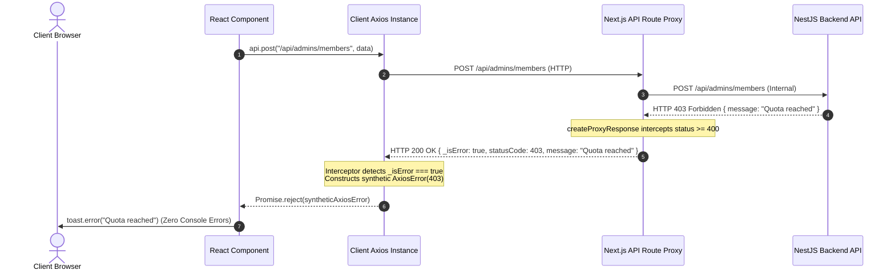

# Frontend developer guide

This guide describes the Next.js 16 sports club management and SaaS owner client applications implemented in this frontend repository (`frontend` and `owner-platform`). It covers portal administration, club staff and member interfaces, authentication, design system components, attendance QR scanning, analytics, internationalization, state management, and API proxy integration. Technical details are based on the current source and configuration; commands below are instructions, not a record of successful execution.

## Contents

- [Architecture and source map](#architecture-and-source-map)
- [Technology stack](#technology-stack)
- [Package commands](#package-commands)
- [Roles, tenancy, and portal routing](#roles-tenancy-and-portal-routing)
- [Authentication and sessions](#authentication-and-sessions)
- [Design system, themes, and UI conventions](#design-system-themes-and-ui-conventions)
- [API integration, error proxying, and caching](#api-integration-error-proxying-and-caching)
- [Internationalization (i18n) and RTL layout engine](#internationalization-i18n-and-rtl-layout-engine)
- [Hardware and real-time integrations](#hardware-and-real-time-integrations)
- [Individual contributions and engineering challenges](#individual-contributions-and-engineering-challenges)
- [42 Evaluation modules and compliance](#42-evaluation-modules-and-compliance)
- [Troubleshooting](#troubleshooting)
- [Route and portal reference](#route-and-portal-reference)

## Architecture and source map

The client-side architecture consists of two distinct Next.js 16 applications running the **App Router**:
1. **`frontend/`** (default port `3001`): The primary multi-tenant portal serving Facility Administrators, Staff, and Members under role-scoped portal layouts.
2. **`owner-platform/`** (default port `3002`): The platform administration dashboard for SaaS owners to manage client gyms, plan tiers, and global system metrics.

Requests pass through Next.js server middleware/layouts, role and authentication checks (`useCurrentUser`), layout shells (`SimpleAuthShell` / portal navigation), and render reactive Client Components. Client components query backend services through Next.js API proxy routes (`src/app/api/...`), which encapsulate responses and standardize error handling before reaching client-side Axios interceptors.

```text
frontend/
├── public/                 Static branding assets, icons, default avatar images
├── src/
│   ├── app/                Next.js 16 App Router route hierarchy
│   │   ├── (auth)/         Public sign-in, registration, and credential recovery pages
│   │   ├── (portal)/       Role-protected portal views (dashboard, members, staffs, etc.)
│   │   ├── api/            Next.js Route Handlers acting as internal API proxies
│   │   │   ├── admins/     Admin-scoped proxies (members, staffs, visits, stats, payments)
│   │   │   ├── staffs/     Staff-scoped proxies (members, visits, stats)
│   │   │   ├── auth/       Authentication, refresh, and verification proxies
│   │   │   └── users/      Self-profile, avatar, and credential proxies
│   │   ├── layout.tsx      Root HTML shell (i18n provider, theme script, ToastContainer)
│   │   ├── globals.css     Tailwind CSS 4 configuration and Toota design tokens
│   │   ├── privacy/        Mandatory Privacy Policy compliance route
│   │   └── terms/          Mandatory Terms of Service compliance route
│   ├── components/         Component hierarchy based on the Toota design system
│   │   ├── auth/           Auth cards, login forms, email change & verification shells
│   │   ├── checkin/        HTML5 video QR scanner and manual check-in modal
│   │   ├── feedbacks/      Review cards, sentiment badges, and resolution modal
│   │   ├── members/        Member tables, AddMemberModal, and status actions
│   │   ├── staffs/         Staff tables, AddStaffModal, and action menus
│   │   ├── navigation/     Responsive Sidebar, Header, LanguageSwitcher, ThemeToggle
│   │   └── ui/             Toota UI primitives (Button, Card, Badge, Table, Dialog, Avatar)
│   ├── hooks/              Custom hooks (useAuthToken, useCurrentUser, useDebounce)
│   ├── lib/                Client utilities, Axios instances, proxy handlers, i18n
│   │   ├── axios.ts        Client Axios instance with synthetic error interceptors
│   │   ├── server-auth.ts  createProxyResponse utility for clean console errors
│   │   ├── i18n.ts         i18next setup (en, fr, ar dictionaries and RTL detection)
│   │   └── api/            Domain API caller functions (members, stats, auth, feedback)
│   └── types/              TypeScript domain interfaces matching Prisma schema models
├── next.config.ts          Turbopack and Next.js compiler settings
├── package.json / package-lock.json
└── .env.example
```

| Source | Responsibility |
| --- | --- |
| [app/(portal)/dashboard](../frontend/src/app/(portal)/dashboard/page.tsx) | Executive KPI summary cards, member review leaderboard, attendance trends, operating hours |
| [app/(portal)/members](../frontend/src/app/(portal)/members/page.tsx) | Member roster table, first/last name search, status filters, AddMemberModal, detail view |
| [app/(portal)/staffs](../frontend/src/app/(portal)/staffs/page.tsx) | Club staff directory, AddStaffModal, status toggling (`ACTIVE`, `PENDING`, `BANNED`) |
| [app/(portal)/check-in](../frontend/src/app/(portal)/check-in/page.tsx) | Real-time camera QR scanner desk and manual member check-in lookup |
| [app/(portal)/feedbacks](../frontend/src/app/(portal)/feedbacks/page.tsx) | Club review feed, AI sentiment badges, discrepancy warnings, resolution notes, CSV export |
| [app/(portal)/membership-plans](../frontend/src/app/(portal)/membership-plans/page.tsx) | Club plan catalog, duration prices, weekly visit limit configuration |
| [app/(portal)/payments](../frontend/src/app/(portal)/payments/page.tsx) | Financial payment ledger, payment status badges (`PAID`, `PENDING`), CSV export |
| [app/(portal)/operating-hours](../frontend/src/app/(portal)/operating-hours/page.tsx) | Regular weekly opening hours and special date closure management |
| [app/(portal)/profile](../frontend/src/app/(portal)/profile/page.tsx) | Self-profile inspection, avatar upload/delete via Cloudinary, email change requests |
| [components/auth/](../frontend/src/components/auth/) | Role-specific login forms, registration, password recovery, `<Suspense>` token wrappers |
| [lib/server-auth.ts](../frontend/src/lib/server-auth.ts) | Server-side `createProxyResponse` encapsulating backend errors to prevent browser console red error logs |
| [lib/axios.ts](../frontend/src/lib/axios.ts) | Client Axios instance rejecting synthetic errors from `_isError` proxy responses |
| [lib/api/cache.ts](../frontend/src/lib/api/cache.ts) | Client-side memory cache with TTL management and selective invalidation |
| [owner-platform/](../owner-platform/) | Dedicated platform administration app for SaaS client businesses and plan durations |

## Technology stack

These are **declared ranges** from [package.json](../frontend/package.json) and **resolved versions recorded in package-lock.json**.

| Component | Declared | Lockfile resolution | Justification |
| --- | --- | --- | --- |
| Next.js | `^16.4.3` | `16.4.3` | React production framework; App Router, SSR, nested layouts, API route proxies |
| React / React-DOM | `19.2.8` | `19.2.8` | Core UI library; modern hooks (`useTransition`, `useMemo`, `Suspense`) |
| Tailwind CSS | `^4` | `4.3.3` | Utility-first CSS engine with native logical properties (`ms-`, `me-`) for RTL support |
| TypeScript | `^5` | `5.9.3` | Static typing across API responses, component props, and domain contracts |
| Axios | `^1.20.0` | `1.20.0` | HTTP client with request/response interceptors and synthetic error reconstruction |
| i18next | `^26.4.2` | `26.5.10` | Internationalization framework for multi-language dictionary management |
| react-i18next | `^17.0.15` | `17.1.9` | React bindings for reactive language switching and direction updates |
| html5-qrcode | `^2.3.8` | `2.3.8` | Real-time browser video QR code scanner utilizing device camera streams |
| Lucide React | `^1.46.0` | `1.61.0` | Accessible, tree-shakeable SVG icon set conforming to the Toota design language |
| React Toastify | `^11.1.0` | `11.1.0` | Non-blocking accessible toast notifications communicating backend feedback cleanly |
| Zod | `^4.6.5` | `4.6.7` | Client-side schema definition and input validation |
| Framer Motion | `^13.4.4` | `13.5.1` | Hardware-accelerated UI animations and modal transition effects |
| Ethers | `^6.17.0` | `6.17.0` | Web3 client library for MetaMask wallet connectivity and transaction signing |

The Docker container runs on `node:20-alpine` (or `node:22-alpine`). Port `3001` serves the main frontend application, and port `3002` serves the owner platform. In production, Nginx proxies port `443` HTTPS traffic to these internal ports.

## Package commands

These are the exact scripts defined in [frontend/package.json](../frontend/package.json) and [owner-platform/package.json](../owner-platform/package.json).

| Command | Script | Purpose |
| --- | --- | --- |
| `npm run dev` | `next dev -p 3001` | Launch development server on port 3001 |
| `npm run build` | `next build` | Compile optimized production build with Turbopack |
| `npm start` | `next start -p 3001` | Launch production server on port 3001 |
| `npm run lint` | `eslint` | Run ESLint across source files |
| `npx tsc --noEmit` | `tsc --noEmit` | Run TypeScript compiler type verification without emitting files |

For `owner-platform`, scripts target port `3002`:
```bash
# Development server for owner platform
cd owner-platform && npm run dev    # Starts on http://localhost:3002

# Type verification
npx tsc --noEmit
```

## Roles, tenancy, and portal routing

The application enforces role-based tenant isolation across four distinct roles matching the backend enum: `OWNER`, `ADMIN`, `STAFF`, and `MEMBER`.

| Role | Portal / Application | Accessible Routes & Functional Boundary |
| --- | --- | --- |
| `OWNER` | `owner-platform` (`:3002`) | Subscribed facilities, plan configurations, pricing durations, owner profile |
| `ADMIN` | `frontend` (`:3001`) | Full club authority: staff roster, member roster, plan creation, financial ledger, operating hours, review moderation, executive dashboard |
| `STAFF` | `frontend` (`:3001`) | Club desk operations: QR check-in camera, manual check-in lookup, member roster, review resolution, read-only hours/plans |
| `MEMBER` | `frontend` (`:3001`) | Personal membership status, upcoming visits, personal QR visit pass, feedback submission, loyalty rewards marketplace, profile |

### Tenant resolution and state management

- On the main platform, tenant scope is determined by the authenticated user's session (`useCurrentUser`). Administrators own the facility; staff and members resolve their club through the database `adminId`.
- Navigation sidebars and action controls evaluate `role` dynamically. For example, the **Add Member** button and member action dropdowns (`Active`, `Pending`, `Ban`) are visible to Admins and Staff, while financial ledger and plan creation controls are restricted to Admins.
- Unauthenticated or unauthorized page transitions are caught by client-side route guards, which redirect users to the appropriate login page (`/login`, `/staff/login`, `/member/login`, or `/owner-portal/login`).

### Account and membership status fields

| Status field | Values | UI Treatment & Behavior |
| --- | --- | --- |
| `accountStatus` | `ACTIVE`, `PENDING`, `BANNED` | Displayed via status badges; `BANNED` shows red destructive pill, `PENDING` shows amber badge, `ACTIVE` shows green pill |
| `membershipStatus` | `ACTIVE`, `EXPIRED`, `CANCELLED` | Displayed on membership cards and member profiles; expired memberships disable visit bookings |
| `visitStatus` | `READY`, `CHECKED_IN`, `CANCELLED`, `EXPIRED` | Rendered on member visit passes and desk check-in tables |
| `feedbackStatus` | `OPEN`, `IN_REVIEW`, `RESOLVED`, `DISMISSED` | Moderation badge in the feedback feed; `RESOLVED` reveals resolution notes and timestamp |

## Authentication and sessions

Sources: [components/auth/](../frontend/src/components/auth/), [hooks/useAuthToken.ts](../frontend/src/hooks/useAuthToken.ts), [lib/axios.ts](../frontend/src/lib/axios.ts), and Next.js route proxies under [app/api/auth/](../frontend/src/app/api/auth/).

### Login workflows and token storage

1. **Credentials Submission:** Login forms submit credentials to the Next.js API route proxies (`/api/auth/login`, `/api/auth/staffs/login`, `/api/auth/members/login`).
2. **Token Receipt & Storage:** The backend returns an `accessToken` (JWT) and sets a secure `refresh_token` HTTP-only cookie. The client stores the user object in `localStorage` (`gym_user`) and configures Axios headers.
3. **Silent Token Refresh:** When an access token expires, Axios intercepts the 401 response and requests `/api/auth/{admins|staffs|members}/refresh`. The proxy forwards the refresh cookie to the backend, retrieves a fresh access token, and retries the original request seamlessly.
4. **Logout:** Submits to `/api/auth/{admins|staffs|members}/logout`, clearing client storage and instructing the backend to revoke the refresh token and clear the cookie.

### Resilient action token parsing (`useAuthToken`)

Email verification, password reset, set-password, and email change links deliver action tokens via email. The backend crafts links using URL hash fragments (`#token=XYZ`) to prevent sensitive tokens from leaking into web server access logs.

[useAuthToken](../frontend/src/hooks/useAuthToken.ts) extracts tokens with dual-mode resilience:
1. **Hash Fragment Inspection:** Reads `window.location.hash`, stripping `#` and parsing parameters formatted as `token=XYZ` or raw token strings.
2. **Query Parameter Fallback:** If no hash is present, parses standard URL search parameters (`?token=XYZ`).

### Password recovery and email verification

- **Email Verification:** Public route `/email-verification` reads the token, calls the verification proxy, and displays confirmation with a direct link to sign in.
- **Password Reset:** Routes `/reset-password`, `/staff/reset-password`, and `/member/reset-password` validate new password requirements using client-side rules before submission.
- **Suspense Boundary Encapsulation:** All pages reading `useSearchParams` or `useAuthToken` wrap client components inside React `<Suspense>` boundaries to prevent Next.js App Router static prerendering bailouts during `next build`.

## Design system, themes, and UI conventions

The user interface is governed by the **Toota Design System**, a purpose-built component library engineered for operational SaaS applications.

### Design tokens

Tokens are defined in [globals.css](../frontend/src/app/globals.css) using CSS custom properties:
- `--toota-bg`: Base canvas background (pure white in light mode, deep zinc `#09090b` in dark mode).
- `--toota-card`: Elevated card container background (`#ffffff` / `#121215`).
- `--toota-inner`: Secondary nested surface for table rows, inputs, and search bars (`#f4f4f5` / `#18181b`).
- `--toota-ink`: Primary high-contrast text color (`#09090b` / `#fafafa`).
- `--toota-muted`: Secondary metadata and label text color (`#71717a` / `#a1a1aa`).
- `--toota-primary`: Brand green accent (`#00e599` / `#10b981`).
- `--toota-red`: Destructive status and error color (`#ef4444`).
- `--toota-amber`: Warning and pending status color (`#f59e0b`).

### Zero Flash of Unstyled Content (FOUC)

To prevent visual flickering when loading in dark mode, an inline script executes synchronously in the document `<head>` of [layout.tsx](../frontend/src/app/layout.tsx):
```html
<script>
  (function() {
    try {
      const stored = localStorage.getItem("theme");
      const prefersDark = window.matchMedia("(prefers-color-scheme: dark)").matches;
      if (stored === "dark" || (!stored && prefersDark)) {
        document.documentElement.classList.add("dark");
      } else {
        document.documentElement.classList.remove("dark");
      }
    } catch (e) {}
  })();
</script>
```

### Component conventions

- **Cards:** Wrapped in `.toota-card` with subtle border-subtle and shadow-2xs.
- **Buttons:** Styled with `.toota-pill` or standard variants (`default`, `outline`, `ghost`, `destructive`).
- **Badges:** Micro-badges displaying rounded status indicators with colored 6px dot markers.
- **Modal Dialogs:** Controlled components with focus trapping, ESC key dismiss, and backdrop blur.

## API integration, error proxying, and caching

### Clean console error proxy pattern (`createProxyResponse`)

In standard browser environments, native `XMLHttpRequest` unconditionally logs red network errors in the DevTools console whenever an HTTP 4xx or 5xx status is returned (e.g. `POST /api/admins/members 403 (Forbidden)`).

To guarantee a clean console during evaluation, the Next.js API layer encapsulates backend errors:



[createProxyResponse](../frontend/src/lib/server-auth.ts) converts any status `>= 400` into an HTTP 200 payload containing `{ _isError: true, statusCode, ...backendData }`. On the client, [lib/axios.ts](../frontend/src/lib/axios.ts) inspects responses; if `_isError === true`, it rejects the promise with a synthetic `AxiosError`. The UI catches the rejection and displays user-friendly notifications via `react-toastify` without any red errors leaking to the console.

### Client-side caching (`cache.ts`)

[lib/api/cache.ts](../frontend/src/lib/api/cache.ts) implements an in-memory cache-aside mechanism for high-frequency, expensive statistics:
- **`STATS_TTL_MS = 15_000` (15 seconds):** Caches member stats, visit stats, and feedback stats.
- **Selective Invalidation:** Mutations (e.g., adding a member, cancelling a visit) call `invalidateCache("stats:admin:members")`, ensuring UI stats update immediately without stale data.

### Query parameters and pagination conventions

All paginated endpoints pass `page` and `limit` as integer query parameters. Search inputs query the backend dynamically with debounce:
- **Member Search:** Sends `?page=1&limit=20&search=mohamed`, matching first name or last name on the server.
- **Owner Subscription Search:** Sends `?page=1&limit=20&search=89f622a1`, matching subscription UUIDs.

## Internationalization (i18n) and RTL layout engine

Internationalization is managed by `i18next` and initialized in [lib/i18n.ts](../frontend/src/lib/i18n.ts).

### Multi-language support

Three complete translation dictionaries are embedded in the bundle:
- **English (`en`):** Default locale.
- **French (`fr`):** Complete European French translation.
- **Arabic (`ar`):** Modern Standard Arabic with full vocabulary coverage.

### Bidirectional layout (RTL)

When switching to Arabic:
1. `i18next.on("languageChanged")` dynamically updates `<html dir="rtl" lang="ar">`.
2. Tailwind CSS logical properties automatically invert margins and alignments:
   - `ms-` (margin-inline-start) replaces `ml-`.
   - `me-` (margin-inline-end) replaces `mr-`.
   - `text-start` replaces `text-left`.
3. Directional icons (arrows, chevrons) utilize `rtl:rotate-180` to mirror their orientation automatically.

## Hardware and real-time integrations

### In-browser camera QR check-in scanner

Implemented in [components/checkin/](../frontend/src/components/checkin/):
- **Camera Stream Binding:** Drives device video streams via `html5-qrcode`.
- **Validation Pipeline:** Decodes scanned QR token strings and submits them to `POST /api/{admins|staffs}/attendances/check-in/qr` with body `{ rowToken: decodedText }`.
- **Audio & Visual Feedback:** Plays an audio confirmation beep and flashes a green success card on check-in, or displays an explanatory error toast if the visit window is expired or invalid.
- **Lifecycle Teardown:** Explicit cleanup in `useEffect` ensures camera hardware is released immediately when navigating away.

### AI sentiment analysis display

Implemented in [app/(portal)/feedbacks/page.tsx](../frontend/src/app/(portal)/feedbacks/page.tsx):
- **Micro-Badges:** Calls `renderSentimentBadge(item.sentimentType || item.sentiment, item.sentimentScore)` to display color-coded sentiment indicators (`Positive`, `Neutral`, `Negative`) with confidence percentages (e.g., `Positive · 89%`).
- **Discrepancy Micro-Badge (`starsDisagree`):** Highlights reviews where star rating diverges from text sentiment (rating $\ge$ 4 with `NEGATIVE` sentiment, or rating $\le$ 2 with `POSITIVE` sentiment).

### Web3 loyalty rewards marketplace

Implemented in [app/(portal)/marketplace/page.tsx](../frontend/src/app/(portal)/marketplace/page.tsx):
- **MetaMask Bridge:** Connects to the browser's Ethereum provider (`window.ethereum`) via `ethers.js`.
- **Transaction Signing:** Prompts users to sign redemptions for gym merchandise using accumulated member reward tokens.

## Individual contributions and engineering challenges

### ael-jama (Frontend Developer)

**Assigned Role:** Frontend Developer & UI/UX Engineer  
**Core Responsibilities:** Architecture of both client applications (`frontend` and `owner-platform`), Toota design system, state management, form validation, API integration, internationalization, accessibility, and cross-browser testing.

#### Detailed contributions
1. **Multi-Platform Client Architecture:** Developed two separate Next.js 16 App Router applications sharing unified design tokens and TypeScript contracts.
2. **Authentication & Session Security:** Built dedicated sign-in interfaces, registration forms with live field validation, password reset, and dynamic token extraction (`useAuthToken`).
3. **Clean Console Error Architecture:** Designed and implemented `createProxyResponse` across all Next.js API routes, suppressing red browser network errors in the DevTools console while maintaining rich client toast feedback.
4. **Toota Design System:** Created semantic CSS design tokens, dark/light theme switching with zero FOUC, and an accessible component library (buttons, cards, badges, modals, data tables).
5. **Roster Management:** Developed member and staff management tables with real-time status toggling (`ACTIVE`, `PENDING`, `BANNED`), search, pagination, and modal forms.
6. **QR Code Attendance System:** Integrated `html5-qrcode` camera scanning with audio feedback and manual search fallback for front-desk receptionists.
7. **Executive Dashboards & Analytics:** Built real-time KPI metric cards (Total Members, Active Subscriptions, Inactive/Other with explicit `bannedCount` & `pendingCount` metrics), member review leaderboards, and working hours cards.
8. **Feedback & Sentiment Analysis UI:** Built review feeds displaying AI sentiment badges with score percentages, rating discrepancy warning micro-badges, and resolution note modals.
9. **Internationalization & RTL Engine:** Integrated `i18next` for English, French, and Arabic with automatic `dir="rtl"` layout mirroring.

#### Engineering challenges and solutions
- *Browser Console Error Suppression:* Solved native browser XHR red error logging on 4xx/5xx responses by encapsulating errors into HTTP 200 proxy responses with `_isError: true` and reconstructing synthetic `AxiosError` objects on the client.
- *Next.js CSR Bailout on Static Compilation:* Solved `missing-suspense-with-csr-bailout` build errors on query-driven routes by wrapping search parameter extraction inside React `<Suspense>` boundaries.
- *Dark Mode Flash of Unstyled Content (FOUC):* Eliminated white screen flashes on dark mode reloads via an inline, blocking theme resolution script in the document `<head>`.
- *Dynamic RTL Layout Mirroring:* Eliminated layout breakage when switching to Arabic by enforcing Tailwind CSS logical properties (`ms-`, `me-`, `text-start`) and dynamic document direction synchronization.
- *Camera Hardware Stream Teardown:* Prevented background camera hardware locking on mobile devices through strict React `useEffect` cleanup routines.

## 42 Evaluation modules and compliance

| Module Name | Type | Category | Frontend Implementation Details |
|---|---|---|---|
| **Frontend Framework (Next.js 16)** | Minor | Web | Two Next.js 16 App Router applications utilizing React 19, nested layouts, and server proxies |
| **Server-Side Rendering (SSR)** | Minor | Web | Hybrid rendering: server-rendered public and legal pages, client-hydrated interactive portals |
| **Custom Design System (Toota)** | Minor | Web | Semantic color tokens, reusable UI component library, and zero-FOUC theme engine |
| **Multi-Language Support** | Minor | Accessibility | Complete translation catalogs in English, French, and Arabic via `i18next` |
| **Right-to-Left (RTL) Layout** | Minor | Accessibility | Dynamic `dir="rtl"` switching and Tailwind CSS logical property layout mirroring |
| **Additional Browsers** | Minor | Compatibility | Tested, verified, and polyfilled on Chrome, Firefox, Safari, and Edge |
| **User Management & Authentication** | **Major** | User Management | Multi-portal login, registration, email verification, password reset, and profile management |
| **Advanced Permissions System** | **Major** | Security | Client-side role-based routing guards, navigation filtering, and action authorization |
| **Advanced Analytics Dashboard** | **Major** | Analytics | Real-time KPI summary cards, review leaderboard, and weekly attendance visual charts |
| **User Activity Analytics** | Minor | Analytics | Attendance metrics comparing QR code check-ins versus manual desk entries |
| **Advanced Search & Pagination** | Minor | Web | Dynamic name and subscription ID search with server-side query filtering and pagination |
| **Sentiment Analysis UI** | Minor | AI | Color-coded AI sentiment badges, score confidence percentages, and rating discrepancy warnings |
| **Web3 Rewards Marketplace** | Minor | Blockchain | MetaMask wallet connectivity, rewards balance display, and product redemption signing |

### Mandatory compliance documents (Page 9)
- **Privacy Policy:** [`/privacy`](../frontend/src/app/privacy/page.tsx) — Documents data processing, identity protection, and camera permission handling.
- **Terms of Service:** [`/terms`](../frontend/src/app/terms/page.tsx) — Defines terms of service for facility memberships and platform accounts.

## Troubleshooting

| Symptom | Implementation-grounded checks |
| --- | --- |
| Red network errors appear in DevTools console | Ensure the Next.js API proxy route wraps backend responses with `createProxyResponse(res)`. Verify that client code imports the configured `api` instance from `src/lib/axios.ts` rather than native `fetch` |
| `next build` fails with missing Suspense boundary | Check if `useSearchParams()` or dynamic query hooks are used in a Client Component without a surrounding React `<Suspense>` boundary |
| White flash occurs when loading in dark mode | Inspect `layout.tsx`; verify that the inline theme detection script is placed directly inside `<head>` before the body renders |
| Layout does not mirror when switching to Arabic | Verify that `i18n.ts` is triggering `document.documentElement.dir = "rtl"`. Ensure styles use logical properties (`ms-`, `me-`) instead of physical margins (`ml-`, `mr-`) |
| Camera scanner fails to start or says camera locked | Ensure the previous scanner instance was destroyed cleanly via `html5QrCode.stop()`. Verify browser camera permissions in site settings |
| Token extraction fails on email link click | Check whether the token is in the query string (`?token=...`) or hash fragment (`#token=...`). The `useAuthToken` hook parses both formats |
| Dashboard KPI metrics show stale numbers | Check cache expiration in `src/lib/api/cache.ts`. Mutations must invoke `invalidateCache("stats:admin:members")` to bypass the 15-second TTL |
| Sentiment badge displays "Not Analyzed" | Verify that the component receives `item.sentimentType` (not legacy `sentiment`) and `item.sentimentScore` |

## Route and portal reference

### Public and authentication pages

| Route | Application | Access | Description |
| --- | --- | --- | --- |
| `/` | `frontend` | Public | Marketing landing page and portal gateway |
| `/login` | `frontend` | Public | Facility Administrator login screen |
| `/register` | `frontend` | Public | Facility Administrator account registration |
| `/forgot-password` | `frontend` | Public | Administrator password reset request |
| `/reset-password` | `frontend` | Action token (`#token=`) | Administrator password reset submission |
| `/email-verification` | `frontend` | Action token (`#token=`) | Account activation and email verification |
| `/email-change` | `frontend` | Action token (`#token=`) | Email change confirmation |
| `/staff/login` | `frontend` | Public | Staff portal login screen |
| `/staff/forgot-password` | `frontend` | Public | Staff password reset request |
| `/staff/reset-password` | `frontend` | Action token (`#token=`) | Staff password reset submission |
| `/staff/set-password` | `frontend` | Action token (`#token=`) | Staff initial password configuration |
| `/member/login` | `frontend` | Public | Member portal login screen |
| `/member/forgot-password` | `frontend` | Public | Member password reset request |
| `/member/reset-password` | `frontend` | Action token (`#token=`) | Member password reset submission |
| `/member/set-password` | `frontend` | Action token (`#token=`) | Member initial password configuration |
| `/owner-portal/login` | `owner-platform` | Public | Platform Owner administration login |
| `/privacy` | `frontend` | Public | Mandatory Privacy Policy document |
| `/terms` | `frontend` | Public | Mandatory Terms of Service document |

### Protected portal pages (`frontend`)

| Route | Role required | Description |
| --- | --- | --- |
| `/dashboard` | ADMIN / STAFF | Executive statistics, KPI cards, review leaderboard, operating hours |
| `/members` | ADMIN / STAFF | Member directory table, status filtering, AddMemberModal |
| `/members/:id` | ADMIN / STAFF | Member detailed profile, memberships, payment ledger, attendance logs |
| `/staffs` | ADMIN | Facility staff directory, AddStaffModal, account status actions |
| `/staffs/:id` | ADMIN | Detailed staff member profile and credentials view |
| `/check-in` | ADMIN / STAFF | Real-time camera QR attendance scanner desk and manual check-in lookup |
| `/membership-plans` | ADMIN / STAFF | Club membership plans, pricing tiers, and duration limits |
| `/payments` | ADMIN | Financial ledger of member payments with CSV export |
| `/operating-hours` | ADMIN / STAFF | Regular weekly opening hours and special closure date management |
| `/feedbacks` | ADMIN / STAFF | Member reviews feed, AI sentiment analysis, resolution modal |
| `/marketplace` | MEMBER | Web3 loyalty rewards catalog with MetaMask wallet integration |
| `/visits` | MEMBER | Upcoming booked visits and personal QR check-in pass display |
| `/profile` | ADMIN / STAFF / MEMBER | User self-profile, avatar upload/delete via Cloudinary, email change |
| `/assistant` | ADMIN / STAFF | AI-powered assistant chatbot for operational recommendations |

### Next.js API proxy routes (`frontend/src/app/api/...`)

All client requests target these Next.js Route Handlers, which proxy to the internal backend (`http://backend:3000`) and apply `createProxyResponse` error encapsulation:

| Proxy Route | Upstream Backend Endpoint | Methods | Access |
| --- | --- | --- | --- |
| `/api/auth/login` | `/api/auth/login` | POST | Public |
| `/api/auth/register` | `/api/auth/register` | POST | Public |
| `/api/auth/email-verification` | `/api/auth/email-verification` | POST | Action token |
| `/api/auth/forgot-password` | `/api/auth/forgot-password` | POST | Public |
| `/api/auth/reset-password` | `/api/auth/reset-password` | POST | Action token |
| `/api/auth/admins/refresh` | `/api/auth/admins/refresh` | POST | Admin refresh cookie |
| `/api/auth/staffs/login` | `/api/auth/staffs/login` | POST | Public |
| `/api/auth/staffs/refresh` | `/api/auth/staffs/refresh` | POST | Staff refresh cookie |
| `/api/auth/members/login` | `/api/auth/members/login` | POST | Public |
| `/api/auth/members/refresh` | `/api/auth/members/refresh` | POST | Member refresh cookie |
| `/api/admins/members` | `/api/admins/members` | GET, POST | ADMIN |
| `/api/admins/members/:id` | `/api/admins/members/:id` | GET, PATCH | ADMIN |
| `/api/admins/members/active/:id` | `/api/admins/members/active/:id` | PATCH | ADMIN |
| `/api/admins/members/pending/:id` | `/api/admins/members/pending/:id` | PATCH | ADMIN |
| `/api/admins/members/ban/:id` | `/api/admins/members/ban/:id` | PATCH | ADMIN |
| `/api/admins/members/stats` | `/api/admins/members/stats` | GET | ADMIN |
| `/api/staffs/members` | `/api/staffs/members` | GET, POST | STAFF |
| `/api/staffs/members/stats` | `/api/staffs/members/stats` | GET | STAFF |
| `/api/admins/attendances/check-in/qr` | `/api/admins/attendances/check-in/qr` | POST | ADMIN |
| `/api/staffs/attendances/check-in/qr` | `/api/staffs/attendances/check-in/qr` | POST | STAFF |
| `/api/admins/attendances/check-in/manual`| `/api/admins/attendances/check-in/manual`| POST | ADMIN |
| `/api/staffs/attendances/check-in/manual`| `/api/staffs/attendances/check-in/manual`| POST | STAFF |
| `/api/admins/payments` | `/api/admins/payments` | GET | ADMIN |
| `/api/admins/payments/stats` | `/api/admins/payments/stats` | GET | ADMIN |
| `/api/admins/feedbacks` | `/api/admins/feedbacks` | GET | ADMIN |
| `/api/admins/feedbacks/:id` | `/api/admins/feedbacks/:id` | GET, PATCH | ADMIN |
| `/api/admins/feedbacks/stats` | `/api/admins/feedbacks/stats` | GET | ADMIN |
| `/api/admins/visits/today` | `/api/admins/visits/today` | GET | ADMIN |
| `/api/staffs/visits/today` | `/api/staffs/visits/today` | GET | STAFF |
| `/api/users/admins/me` | `/api/users/admins/me` | GET | ADMIN |
| `/api/users/admins/edit-profile` | `/api/users/admins/edit-profile` | PATCH | ADMIN |
| `/api/users/admins/profile-image` | `/api/users/admins/profile-image` | POST, DELETE | ADMIN |
| `/api/users/staffs/me` | `/api/users/staffs/me` | GET | STAFF |
| `/api/users/members/me` | `/api/users/members/me` | GET | MEMBER |
