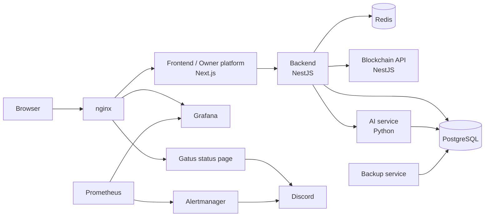
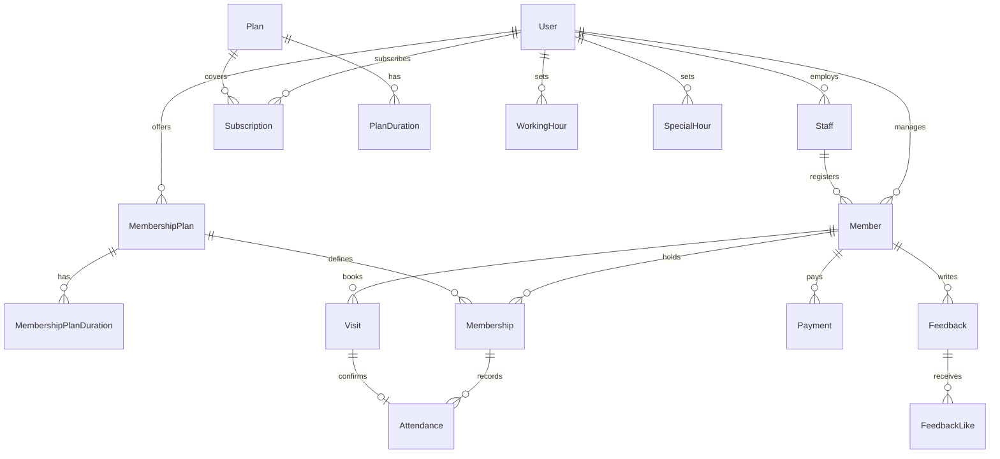

*This project has been created as part of the 42 curriculum by oboussel, mdahani, mait-all, ael-jama, obarais.*

# Sportium

## Description

**Sportium** is a multi-tenant platform for managing sports facilities such as gyms and swimming pools. A facility's owner, staff, and members all work in one place, and the Sportium team (the *platform owners*) manages the businesses that use it.

**Goal:** give every facility one system for memberships, attendance, payments, and member feedback, with an AI assistant on top and a blockchain-powered rewards marketplace for members.

### Key features

- Role-based access for four roles: platform owner, admin (the facility), staff, and member
- Member, staff, plan, and membership management for each facility
- QR-code check-in and attendance tracking
- Payments with due-date tracking and notifications
- Member feedback with sentiment analysis
- AI assistant: chatbot, recommendations, and member information lookups
- Marketplace powered by blockchain: members earn rewards and spend them on products, confirmed through MetaMask
- Full monitoring, status page, and automated database backups

## Table of contents

- [Description](#description)
  - [Key features](#key-features)
- [Project structure](#project-structure)
- [Instructions](#instructions)
  - [Prerequisites](#prerequisites)
  - [Setup and run](#setup-and-run)
  - [Access](#access)
  - [Backup and restore](#backup-and-restore)
- [Team Information](#team-information)
- [Project Management](#project-management)
- [Technical Stack](#technical-stack)
  - [Infrastructure and DevOps](#infrastructure-and-devops)
  - [Key technical decisions](#key-technical-decisions)
- [Architecture](#architecture)
- [Database Schema](#database-schema)
  - [Tables](#tables)
- [Features List](#features-list)
- [Individual Contributions](#individual-contributions)
- [Resources](#resources)
  - [Documentation](#documentation)
  - [How AI was used](#how-ai-was-used)

## Project structure

The repository is organized by application service and infrastructure responsibility. The following is a high-level view; individual source files and supporting configuration files are omitted.

```bash
.
├── .github/workflows/        # Github Actions
├── AI/                       # Python AI service
├── backend/                  # Main NestJS API
├── blockchain/               # Blockchain API
├── devops/
│   ├── backup-service/       # Backup Service
│   ├── monitoring/           # Monitoring Stack Service
│   ├── nginx/                # Nginx Configuration
│   ├── redis/                # Redis Configuration
│   ├── docker-compose.yml    # Multi-service Docker Compose configuration
│   └── backups/              # Database backup files
├── docs/                     # Documentations
├── frontend/                 # Facility-facing web application
├── owner-platform/           # Platform owner web application
├── .gitignore                # Ignored files by git
├── Makefile                  # Common Docker Compose commands
├── setup-env                 # Creates service .env files from .env.example files
└── README.md
```

## Instructions

### Prerequisites

- Docker **28.5.2** (with Docker Compose v2)
- `make`
- Free ports 80 and 443 on your machine

### Setup and run

1. Clone the repository and go to its root.
2. Run the environment setup script:
   ```bash
   ./setup-env
   ```
   The script copies the available service `.env.example` files to their corresponding `.env` files only when the destination files do not already exist. Existing `.env` files are left unchanged: the script does not overwrite them or add missing variables. Review each service's environment example and configure its `.env` file as needed.
3. Start everything:
   ```bash
   make up
   ```
4. Run `make help` or `make` to list the available commands.

### Access

| Service | URL |
|---|---|
| Application | https://localhost |
| Owner portal | https://localhost/owner-portal |
| Grafana (dashboards) | https://localhost/grafana |
| Status page (Gatus) | https://status.localhost |

The TLS certificate is self-signed and generated automatically when the nginx image is built, so your browser will show a warning the first time. Accept it to continue. `status.localhost` resolves to your machine automatically on most systems. If it does not, add `127.0.0.1 status.localhost` to `/etc/hosts`.

### Backup and restore

Database backups run automatically on the configured schedule and are saved to `devops/backups/` (7 days of history are kept). A backup also runs once when the stack starts.

For the backup and restore verification procedure, including the database disaster simulation, test-data creation, restore, and data-integrity checks, see [`db-disaster-simulation.md`](docs/db-disaster-simulation.md). It documents the commands used to validate that backups can be restored successfully.

## Team Information

| Login | Role | Responsibilities |
|---|---|---|
| **oboussel** | Product Owner | Owns the product vision and backlog priorities. Built the AI service. |
| **mdahani** | Project Manager | Plans and coordinates the work and the team's progress. Built the backend. |
| **mait-all** | Tech Lead | Technical direction and architecture. Built the DevOps layer: infrastructure, monitoring, CI, and backups. |
| **ael-jama** | Developer | Built the frontend. |
| **obarais** | Developer | Built the blockchain API and the marketplace. |

## Project Management

- **Work organization:** the work was split by service: frontend, backend, AI, blockchain/marketplace, and DevOps. Each service had a clear owner, and features that crossed services were shared between the owners (for example, frontend and backend for most business features).
- **Meetings:** two team meetings per week.
- **Task tracking:** Jira.
- **Communication:** Discord.
- **Version control:** each member works on their own branch. Branches are merged into `development`, which holds the working version. A stable version is then merged into `main`.

## Technical Stack

| Layer | Technology | Why |
|---|---|---|
| Frontend (`frontend`, `owner-platform`) | **Next.js** | Server-side rendering, file-based routing, and one framework for both the facility app and the platform owner dashboard |
| Backend | **NestJS** | A structured, modular architecture that suits a large API with many roles and features |
| Blockchain API | **NestJS** + **MetaMask** | Same framework as the backend; MetaMask lets members confirm sensitive requests with their own wallet |
| AI service | **Python** | Python has the strongest ecosystem for AI work |
| Database | **PostgreSQL** | Relational data with many linked entities (members, memberships, payments, attendance) needs strong integrity and transactions |
| ORM | **Prisma** | Type-safe queries, versioned migrations, and a schema that serves as documentation |
| Cache | **Redis** | Fast in-memory storage for data that is read often |
| Reverse proxy | **nginx** | Single HTTPS entry point in front of all services |

### Infrastructure and DevOps

- **Docker and Docker Compose:** every service runs in a container, and one command starts the whole stack.
- **Prometheus, Grafana, Alertmanager:** metrics collection, dashboards, and alert routing to Discord. Exporters cover the host (node), nginx, PostgreSQL, and Redis.
- **Gatus:** public status page that checks whether each service is reachable, from the outside like a real user. Gatus also sends its own alerts to Discord.
- **Automated backups:** scheduled `pg_dump` backups in a dedicated container, with a tested restore script.
- **GitHub Actions:** continuous integration that lints and builds every service and builds every Docker image on each push and pull request.

### Key technical decisions

- **nginx is the only public entry point.** No other service is published to the host. The frontend reaches the backend over the internal Docker network.
- **Monitoring and the status page are separate on purpose.** Prometheus and Grafana show what is happening *inside* the services over time. Gatus shows whether the services are reachable *right now*, including those that have no metrics exporter, such as the frontend, backend, and AI service.
- **The AI service uses a read-only database role** that can only select the tables and columns it needs. Password columns and QR token hashes are never exposed to it.
- **Automatic setup:** database migrations, the read-only AI role, and the platform owner account are all created automatically at startup, so a fresh clone needs no manual database work.
- **Self-signed certificates are generated at image build time**, so there is no separate script to run before `make up`.

## Architecture



## Database Schema

The database is PostgreSQL, managed through Prisma. The core relationships are shown below. The sections after the diagram list every table.



### Tables

**People and access**

| Table | Purpose | Key fields |
|---|---|---|
| `User` | Platform owner and facility admins | `id`, `email`, `password`, `role`, `companyName`, `walletAddress`, `accountStatus`, `isAccountVerified` |
| `Staff` | Employees of a facility | `id`, `adminId`, `email`, `password`, `role`, `accountStatus` |
| `Member` | Facility customers | `id`, `adminId`, `staffId`, `email`, `password`, `walletAddress`, `accountStatus` |
| `UserRefreshToken`, `StaffRefreshToken`, `MemberRefreshToken` | Refresh tokens for each account type | `jti`, `hash`, `expiresAt`, `revokedAt`, `ip`, `device` |
| `UserActionToken`, `StaffActionToken`, `MemberActionToken` | One-time tokens (email verification, password reset, set password) | `tokenHash`, `type`, `expiresAt`, `usedAt` |

**Platform plans (what facilities subscribe to)**

| Table | Purpose | Key fields |
|---|---|---|
| `Plan` | Plans offered by the platform | `planName`, `maxMembers`, `isActive` |
| `PlanDuration` | Durations and prices of a plan | `planId`, `durationDays`, `price` (Decimal) |
| `Subscription` | A facility's subscription | `userId`, `planId`, `planDurationId`, `subscriptionStatus`, `startedAt`, `expiresAt`, `amount` |

**Facility operations**

| Table | Purpose | Key fields |
|---|---|---|
| `MembershipPlan` | A plan a facility sells to members | `adminId`, `planName`, `weeklyVisitLimit`, `isActive` |
| `MembershipPlanDuration` | Durations and prices of a membership plan | `membershipPlanId`, `durationDays`, `price` (Decimal), `priceByG` |
| `Membership` | A member's active plan | `memberId`, `membershipPlanId`, `membershipStatus`, `startDate`, `expiresAt` |
| `Visit` | A booked visit with a QR token | `memberId`, `membershipId`, `visitDateAndTime`, `visitStatus`, `qrTokenHash` |
| `Attendance` | A recorded check-in | `memberId`, `membershipId`, `visitId`, `attendanceMethod`, `checkedInAt` |
| `Payment` | Member payments | `memberId`, `amount` (Decimal), `dueDate`, `paidAt`, `paymentStatus` |
| `WorkingHour`, `SpecialHour` | Regular and exceptional opening hours | `adminId`, `dayOfWeek`, `startTime`, `endTime`, `isClosed` |

**Feedback and notifications**

| Table | Purpose | Key fields |
|---|---|---|
| `Feedback` | Member feedback | `memberId`, `content`, `rating`, `sentiment`, `sentimentScore`, `feedbackStatus`, `resolvedBy` |
| `FeedbackLike` | Likes on feedback | `feedbackId`, `memberId` |
| `AdminNotification`, `StaffNotification`, `MemberNotification` | In-app notifications | `notificationType`, `title`, `message`, `isRead` |

All tables use a string `id` primary key and have `createdAt` and `updatedAt` timestamps. Money uses `Decimal`, and statuses use enums (for example `Role`: OWNER, ADMIN, STAFF, MEMBER).

## Features List

| Feature | Description | Team members |
|---|---|---|
| **Authentication and roles** | JWT login with access and refresh tokens. Roles: owner, admin, staff, member. | mdahani |
| **Platform owner dashboard** (`owner-portal`) | Manage client businesses (gyms, pools) and their admins. | ael-jama (frontend), mdahani (backend) |
| **Member management** | Create and edit members and manage account status. | ael-jama (frontend), mdahani (backend) |
| **Memberships and plans** | Plans, durations, and payments. | ael-jama (frontend), mdahani (backend) |
| **Attendance / check-in** | QR-based visits and attendance records. | ael-jama (frontend), mdahani (backend) |
| **Feedback** | Members submit feedback. | ael-jama (frontend), mdahani (backend), oboussel (AI) |
| **AI assistant** | Chatbot that gives recommendations and looks up member information. | oboussel |
| **Blockchain marketplace** | Members earn rewards and spend them on products. Sensitive requests are confirmed with MetaMask. | obarais |
| **Infrastructure, monitoring, status page, backups** | nginx configuration, Prometheus, Grafana, Alertmanager, Gatus, and automated `pg_dump` backups. | mait-all |

## Individual Contributions

### oboussel (Product Owner)
- Defined and prioritized the product backlog.
- Built the AI service: the chatbot, recommendations, and member information lookups.
- Contributed the AI side of the feedback feature.

### mdahani (Project Manager)
- Planned and coordinated the team's work.
- Built the backend: JWT authentication with access and refresh tokens, role-based access, and the APIs for the owner platform, members, memberships and plans, attendance, and feedback.

### mait-all (Tech Lead)
- Designed the container architecture and `docker-compose` setup, plus the nginx reverse proxy with HTTPS (certificates generated at build time).
- Built the monitoring stack: Prometheus, Grafana (provisioned datasource and dashboards), Alertmanager with Discord alerts, and exporters for the host, nginx, PostgreSQL, and Redis.
- Built the Gatus status page.
- Built automated PostgreSQL backups with a tested restore procedure.
- Set up GitHub Actions CI: lint, build, and Docker image builds for every service.
- Set up startup automation: migrations, the read-only database role for the AI service.

**Challenges and how they were solved**

- *Alert rules were not loading in Prometheus, so no alerts were sent.* The compose file mounted only `prometheus.yml`, which hid the `alerts/` folder inside the container. Mounting the whole configuration directory fixed it.
- *Stopping Redis did not trigger an alert, but stopping its exporter did.* The built-in `up` metric only shows whether Prometheus can reach the exporter. We added rules on the exporter's own metrics (`redis_up`, `pg_up`, `nginx_up`) so a service failing behind a running exporter is also caught.

### ael-jama (Developer)
- Built the frontend: the owner platform and facility interfaces for members, memberships and plans, attendance, and feedback.

### obarais (Developer)
- Built the blockchain API and the marketplace: rewards, products, and MetaMask confirmation of requests.

## Resources

### Documentation

- [Docker](https://docs.docker.com/) and [Docker Compose](https://docs.docker.com/compose/)
- [nginx](https://nginx.org/en/docs/)
- [Next.js](https://nextjs.org/docs)
- [NestJS](https://docs.nestjs.com/)
- [PostgreSQL](https://www.postgresql.org/docs/)
- [Prisma](https://www.prisma.io/docs)
- [Redis](https://redis.io/docs/)
- [Prometheus](https://prometheus.io/docs/)
- [Grafana](https://grafana.com/docs/grafana/latest/)
- [Alertmanager](https://prometheus.io/docs/alerting/latest/alertmanager/)
- [Gatus](https://github.com/TwiN/gatus)
- [GitHub Actions](https://docs.github.com/en/actions)
- [MetaMask](https://docs.metamask.io/)

### How AI was used

AI assistants were used as helpers, not as replacements for the team's own work. The tasks included:

- **Learning and explanations:** explaining technical concepts, tools, and workflows to help team members understand the technologies used in the project.
- **Frontend:** help with some designs and improvements to the interface.
- **Code review:** checking our code and suggesting improvements.
- **Debugging:** debugging tips and help organizing issues. For example, when the login succeeded but the redirect to the dashboard failed, the assistant suggested adding request loggers in the frontend and backend to trace how requests reached each service, which is how we found the problem.
- **DevOps:** troubleshooting for the monitoring stack.
- **Documentation:** generating drafts of documentation, including this README, which the team reviewed and corrected.
