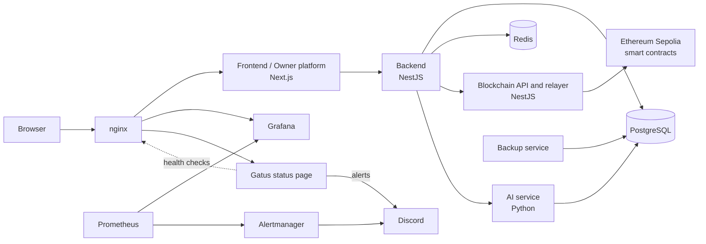
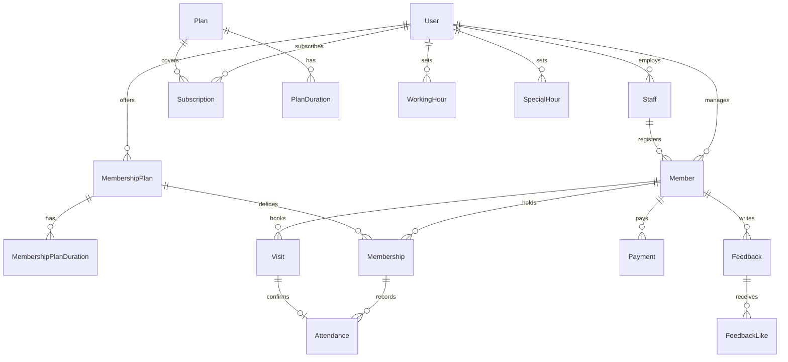

*This project has been created as part of the 42 curriculum by oboussel, mdahani, mait-all, ael-jama, obarais.*

<p align="center">
  
</p>

# Sportium

## Table of Contents

- [Description](#description)
  - [Key features](#key-features)
- [Instructions](#instructions)
  - [Prerequisites](#prerequisites)
  - [Setup and run](#setup-and-run)
  - [Access](#access)
  - [Backup and restore](#backup-and-restore)
- [Team Information](#team-information)
- [Project Management](#project-management)
- [Technical Stack](#technical-stack)
  - [Infrastructure and DevOps](#infrastructure-and-devops)
  - [Blockchain marketplace](#blockchain-marketplace)
  - [Design principles and security practices](#design-principles-and-security-practices)
- [Architecture](#architecture)
- [Project Structure](#project-structure)
- [Database Schema](#database-schema)
- [Features List](#features-list)
- [Modules](#modules)
- [Individual Contributions](#individual-contributions)
- [Resources](#resources)
  - [Documentation](#documentation)
  - [How AI was used](#how-ai-was-used)

## Description

**Sportium** is a multi-tenant platform for managing sports facilities such as gyms and swimming pools. A facility's owner, staff, and members all work in one place, and the Sportium team (the *platform owners*) manages the businesses that use it.

**Goal:** give every facility one system for memberships, attendance, payments, and member feedback, with an AI assistant on top and a blockchain-powered rewards marketplace for members.

### Key features

- Role-based access with an advanced permissions system for four roles: platform owner, admin (the facility), staff, and member
- Member, staff, plan, and membership management for each facility
- QR-code check-in and attendance tracking
- Payments with due-date tracking
- Notifications for create, update, and delete actions
- Advanced search with filters, sorting, and pagination
- Activity analytics and a data visualization dashboard
- Member feedback with sentiment analysis
- AI assistant: chatbot, recommendations, and member information lookups
- Blockchain marketplace on the Ethereum Sepolia testnet: members earn the **G** reward token when they pay for a subscription and spend it on products, with gasless transactions
- Multiple languages, including right-to-left support
- Full monitoring, status page, and automated database backups

## Instructions

### Prerequisites

- Docker **28.5.2** (with Docker Compose v2)
- `make`
- Free ports 80 and 443 on your machine

### Setup and run

1. Clone the repository and go to its root.
2. Prepare the environment files:
   ```bash
   ./setup-env
   ```
   Each service has its own `.env`. This script copies each service's `.env.example` to `.env` when the `.env` does not exist yet. It never overwrites an existing `.env` and does not add missing variables to it. Open the created files and fill in any missing values before the next step. After pulling updates, compare your `.env` files with the `.env.example` files for new variables.
3. Start everything:
   ```bash
   make up
   ```
4. Run `make` with no arguments to list all available commands.

### Access

| Service | URL |
|---|---|
| Application | https://localhost |
| Owner platform | https://localhost/owner-portal |
| Grafana (dashboards) | https://localhost/grafana |
| Status page (Gatus) | https://status.localhost |

The TLS certificate is self-signed and generated automatically when the nginx image is built, so your browser will show a warning the first time. Accept it to continue. `status.localhost` resolves to your machine automatically on most systems. If it does not, add `127.0.0.1 status.localhost` to `/etc/hosts`.

### Backup and restore

The database is backed up automatically on a schedule, and backups are saved to `devops/backups/`. Running a backup manually, restoring one, and verifying the whole procedure (adding data, destroying it, restoring, and checking that it came back) are described step by step in [`docs/db-disaster-simulation.md`](docs/db-disaster-simulation.md).

## Team Information

| Login | Role | Responsibilities |
|---|---|---|
| **oboussel** | Product Owner | Owns the product vision and backlog priorities. Built the AI service. |
| **mdahani** | Project Manager | Plans and coordinates the work and the team's progress. Built the backend. |
| **mait-all** | Tech Lead | Technical direction and architecture. Built the DevOps layer: infrastructure, monitoring, CI, and backups. |
| **ael-jama** | Developer | Built the frontend. |
| **obarais** | Developer | Built the blockchain API and the marketplace. |

## Project Management

- **Work organization:** the work was split by service: frontend, backend, AI, blockchain/marketplace, and DevOps. Each service had a clear owner, and features that crossed services were shared between the owners (for example, frontend and backend for most business features).
- **Meetings:** two team meetings per week.
- **Task tracking:** Jira.
- **Communication:** Discord.
- **Version control:** each member works on their own branch. Branches are merged into `development`, which holds the working version. A stable version is then merged into `main`.

## Technical Stack

| Layer | Technology | Why |
|---|---|---|
| Frontend (`frontend`, `owner-platform`) | **Next.js** | Server-side rendering, file-based routing, and one framework for both the facility app and the platform owner dashboard |
| Backend | **NestJS** | A structured, modular architecture that suits a large API with many roles and features |
| Smart contracts | **Solidity** on **Ethereum Sepolia** | The token, marketplace, purchases, subscriptions, and transfers run on-chain. Sepolia is a free testnet suited to development |
| Blockchain API (relayer) | **NestJS** | Same framework as the backend. Submits signed transactions to the blockchain and pays the network fees |
| Wallet and blockchain access | **MetaMask**, **Ethers.js** | MetaMask connects wallets and signs requests. Ethers.js talks to the blockchain through an Ethereum RPC provider |
| Gasless transactions | **EIP-712**, **ERC-2771** | Signed structured requests and a trusted forwarder let users act without paying gas fees |
| AI service | **Python**, run as an independent microservice | Python has the strongest ecosystem for AI work, and a separate service can be built, secured, and scaled on its own |
| Database | **PostgreSQL** | Relational data with many linked entities (members, memberships, payments, attendance) needs strong integrity and transactions |
| ORM | **Prisma** | Type-safe queries, versioned migrations, and a schema that serves as documentation |
| Cache | **Redis** | Fast in-memory storage for data that is read often, secured with protected mode and a password |
| Reverse proxy | **nginx** | Single HTTPS entry point in front of all services |

### Infrastructure and DevOps

- **Docker and Docker Compose:** every service runs in a container, and one command starts the whole stack.
- **Prometheus, Grafana, Alertmanager:** metrics collection, dashboards, and alert routing to Discord. Exporters cover the host (node), nginx, PostgreSQL, and Redis.
- **Gatus:** status page that checks whether each service is reachable, from the outside like a real user, and alerts Discord when one is not.
- **Automated backups:** scheduled `pg_dump` backups in a dedicated container, with a tested restore script.
- **GitHub Actions:** continuous integration that lints and builds every service and builds every Docker image on each push and pull request.

### Blockchain marketplace

The marketplace is a decentralized system built on smart contracts deployed on the **Ethereum Sepolia testnet**. It lets members of any facility (gym, swimming pool, or other) earn and use a reward token called **G**.

When a member pays for a subscription, they receive G tokens as a reward. They can then use them inside the platform:

- **Members** earn G when they pay for subscriptions, buy products from their facility's marketplace, transfer tokens to other wallet addresses, and pay subscriptions with G.
- **Facility admins** add, edit, and remove marketplace products, receive token payments from members, and update the delivery status of purchased products.

**Gasless transactions.** Every blockchain transaction normally requires the user to pay a gas fee in ETH. To avoid this, the marketplace uses meta-transactions with a trusted forwarder and a backend relayer, so users do not need Sepolia ETH for the supported actions:

1. The user requests a blockchain action.
2. The user signs the request with MetaMask (EIP-712 structured data).
3. The signed request is sent to the NestJS relayer.
4. The relayer validates it and submits the transaction, paying the gas fees (ERC-2771 trusted forwarder).
5. The smart contract executes the requested action on the blockchain.

### Design principles and security practices

**Architecture**

- **The AI service is an independent microservice.** It has its own container, Dockerfile, and dependencies, and can be built, secured, and scaled without touching the rest of the platform.
- **The owner portal is separate from the main platform.** The platform owner dashboard is its own application (`owner-platform`), not a section of the facility app. This limits the exposure of platform-level functions and keeps the two concerns apart.
- **nginx is the only public entry point.** No other service is published to the host. The frontend reaches the backend over the internal Docker network.
- **Monitoring and the status page are separate on purpose.** Prometheus and Grafana show what is happening *inside* the services over time. Gatus shows whether the services are reachable *right now*, including those that have no metrics exporter, such as the frontend, backend, and AI service.
- **Automatic setup:** database migrations, the read-only AI role, and the platform owner account are all created automatically at startup, so a fresh clone needs no manual database work.

**Security**

- **Role-based access control** for members, staff, and facility admins (and platform owners), enforced by the backend on every request.
- **Security best practices across the backend, the AI service, and DevOps.** Passwords and refresh tokens are stored hashed, and refresh tokens can be revoked. Secrets live in per-service `.env` files that are never committed. Internal services are not published to the host, and configuration files are mounted read-only.
- **The AI service uses a read-only database role** that can only select the tables and columns it needs. Password columns and QR token hashes are never exposed to it.

**Containers**

- **Multi-stage Dockerfiles.** Each image is built in a build stage, and the final image contains only what is needed to run, so images are smaller and hold no build tools.
- **Non-root containers.** Each image creates a dedicated non-root user, and the `/app` directory is owned by that user at build time.
- **Self-signed certificates are generated at image build time**, so there is no separate script to run before `make up`.

**Network and caching**

- **HTTP is redirected to HTTPS.** nginx redirects all traffic arriving on port 80 to port 443.
- **Redis is used as a cache** and is secured with `protected-mode yes` and a password.

## Architecture



## Project Structure

```bash
.
├── .github/
│   └── workflows/          # CI: lint, build, and Docker image builds
├── AI/                     # AI service (Python)
│   ├── app/
│   ├── scripts/
│   ├── seeder/             # Seed data and the read-only database role
│   └── Dockerfile
├── backend/                # Backend API (NestJS)
│   ├── helpers/
│   ├── prisma/             # Schema and migrations
│   ├── src/
│   └── Dockerfile
├── block-chain/
│   └── api/                # Blockchain API (NestJS)
│       ├── src/
│       └── Dockerfile
├── devops/
│   ├── backup-service/     # Scheduled backups and restore scripts
│   ├── backups/            # Backup files (not committed)
│   ├── monitoring/
│   │   ├── alertmanager/
│   │   ├── gatus/
│   │   ├── grafana/        # Provisioned datasource and dashboards
│   │   └── prometheus/     # Scrape config and alert rules
│   ├── nginx/              # Reverse proxy and TLS
│   │   ├── conf.d/
│   │   └── nginx.conf
│   ├── redis/              # Redis configuration
│   └── docker-compose.yml
├── frontend/               # Main web application (Next.js)
│   ├── public/
│   ├── src/
│   └── Dockerfile
├── owner-platform/         # Platform owner dashboard (Next.js)
│   ├── public/
│   ├── src/
│   └── Dockerfile
├── .gitignore
├── Makefile
├── setup-env               # Creates each service's .env from .env.example
└── README.md
```

## Database Schema

The database is PostgreSQL, managed through Prisma. The core relationships are shown below. The sections after the diagram list every table.



### Tables

**People and access**

| Table | Purpose | Key fields |
|---|---|---|
| `User` | Platform owner and facility admins | `id`, `email`, `password`, `role`, `companyName`, `walletAddress`, `accountStatus`, `isAccountVerified` |
| `Staff` | Employees of a facility | `id`, `adminId`, `email`, `password`, `role`, `accountStatus` |
| `Member` | Facility customers | `id`, `adminId`, `staffId`, `email`, `password`, `walletAddress`, `accountStatus` |
| `UserRefreshToken`, `StaffRefreshToken`, `MemberRefreshToken` | Refresh tokens for each account type | `jti`, `hash`, `expiresAt`, `revokedAt`, `ip`, `device` |
| `UserActionToken`, `StaffActionToken`, `MemberActionToken` | One-time tokens (email verification, password reset, set password) | `tokenHash`, `type`, `expiresAt`, `usedAt` |

**Platform plans (what facilities subscribe to)**

| Table | Purpose | Key fields |
|---|---|---|
| `Plan` | Plans offered by the platform | `planName`, `maxMembers`, `isActive` |
| `PlanDuration` | Durations and prices of a plan | `planId`, `durationDays`, `price` (Decimal) |
| `Subscription` | A facility's subscription | `userId`, `planId`, `planDurationId`, `subscriptionStatus`, `startedAt`, `expiresAt`, `amount` |

**Facility operations**

| Table | Purpose | Key fields |
|---|---|---|
| `MembershipPlan` | A plan a facility sells to members | `adminId`, `planName`, `weeklyVisitLimit`, `isActive` |
| `MembershipPlanDuration` | Durations and prices of a membership plan (`priceByG` is the price in G tokens) | `membershipPlanId`, `durationDays`, `price` (Decimal), `priceByG` |
| `Membership` | A member's active plan | `memberId`, `membershipPlanId`, `membershipStatus`, `startDate`, `expiresAt` |
| `Visit` | A booked visit with a QR token | `memberId`, `membershipId`, `visitDateAndTime`, `visitStatus`, `qrTokenHash` |
| `Attendance` | A recorded check-in | `memberId`, `membershipId`, `visitId`, `attendanceMethod`, `checkedInAt` |
| `Payment` | Member payments | `memberId`, `amount` (Decimal), `dueDate`, `paidAt`, `paymentStatus` |
| `WorkingHour`, `SpecialHour` | Regular and exceptional opening hours | `adminId`, `dayOfWeek`, `startTime`, `endTime`, `isClosed` |

**Feedback and notifications**

| Table | Purpose | Key fields |
|---|---|---|
| `Feedback` | Member feedback | `memberId`, `content`, `rating`, `sentiment`, `sentimentScore`, `feedbackStatus`, `resolvedBy` |
| `FeedbackLike` | Likes on feedback | `feedbackId`, `memberId` |
| `AdminNotification`, `StaffNotification`, `MemberNotification` | In-app notifications | `notificationType`, `title`, `message`, `isRead` |

All tables use a string `id` primary key and have `createdAt` and `updatedAt` timestamps. Money uses `Decimal`, and statuses use enums (for example `Role`: OWNER, ADMIN, STAFF, MEMBER).

## Features List

| Feature | Description | Team members |
|---|---|---|
| **Authentication and user management** | JWT login with access and refresh tokens, email verification, and password reset. Roles: owner, admin, staff, member. | mdahani (backend), ael-jama (frontend) |
| **Advanced permissions** | Each role can only see and do what its permissions allow. | mdahani (backend), ael-jama (frontend) |
| **Platform owner dashboard** (`owner-platform`) | Manage client businesses (gyms, pools) and their admins. | ael-jama (frontend), mdahani (backend) |
| **Member management** | Create and edit members and manage account status. | ael-jama (frontend), mdahani (backend) |
| **Memberships and plans** | Plans, durations, and payments. | ael-jama (frontend), mdahani (backend) |
| **Attendance / check-in** | QR-based visits and attendance records. | ael-jama (frontend), mdahani (backend) |
| **Feedback with sentiment analysis** | Members submit feedback, and each message is analyzed for sentiment. | ael-jama (frontend), mdahani (backend), oboussel (AI) |
| **Notifications** | Notifications for create, update, and delete actions. | mdahani |
| **Advanced search** | Search with filters, sorting, and pagination. | mdahani (backend), ael-jama (frontend) |
| **Analytics dashboards** | User activity insights and a dashboard with data visualization. | mdahani (backend), ael-jama (frontend) |
| **Design system** | Reusable components with a shared color palette, typography, and icons. | ael-jama |
| **Languages and RTL** | Multiple languages, including right-to-left layout. | ael-jama |
| **Server-side rendering and browser support** | Pages rendered on the server, and the interface works on additional browsers. | ael-jama |
| **AI assistant** | Chatbot that gives recommendations and looks up member information. | oboussel |
| **Blockchain marketplace** | Members earn G tokens when paying subscriptions and use them to buy products, transfer to other wallets, or pay subscriptions. Facility admins manage products, receive payments, and update delivery status. Actions are signed with MetaMask and are gasless through a relayer. | obarais |
| **Infrastructure, monitoring, status page, backups** | nginx configuration, Prometheus, Grafana, Alertmanager, Gatus, and automated `pg_dump` backups. | mait-all |

## Modules

### Summary

| # | Module | Type | Points | Team members |
|---|---|---|---|---|
| 1 | Use a frontend framework (Next.js) | Minor | 1 | ael-jama |
| 2 | Use a backend framework (NestJS) | Minor | 1 | mdahani |
| 3 | Use an ORM for the database (Prisma) | Minor | 1 | mdahani |
| 4 | A complete notification system for all creation, update, and deletion actions | Minor | 1 | mdahani |
| 5 | Server-Side Rendering (SSR) for improved performance and SEO | Minor | 1 | ael-jama |
| 6 | Custom-made design system with reusable components | Minor | 1 | ael-jama |
| 7 | Advanced search functionality with filters, sorting, and pagination | Minor | 1 | mdahani (backend), ael-jama (frontend) |
| 8 | Support for multiple languages (at least 3) | Minor | 1 | ael-jama |
| 9 | Right-to-left (RTL) language support | Minor | 1 | ael-jama |
| 10 | Support for additional browsers | Minor | 1 | ael-jama |
| 11 | Standard user management and authentication | **Major** | 2 | mdahani (backend), ael-jama (frontend) |
| 12 | Advanced permissions system | **Major** | 2 | mdahani (backend), ael-jama (frontend) |
| 13 | User activity analytics and insights dashboard | Minor | 1 | mdahani (backend), ael-jama (frontend) |
| 14 | A complete LLM system interface | **Major** | 2 | oboussel |
| 15 | Sentiment analysis for user-generated content | Minor | 1 | oboussel |
| 16 | Monitoring system with Prometheus and Grafana | **Major** | 2 | mait-all |
| 17 | Health check and status page system with automated backups and disaster recovery procedures | Minor | 1 | mait-all |
| 18 | Advanced analytics dashboard with data visualization | **Major** | 2 | mdahani (backend), ael-jama (frontend) |
| 19 | Decentralized Web3 marketplace with gasless transactions (module of choice) | **Major** | 2 | obarais |

**Point calculation:** 13 Minor modules × 1 point + 6 Major modules × 2 points = 13 + 12 = **25 points**.

### Justification and implementation

**Frameworks and technical foundation**

- **Next.js (module 1):** one framework for both web applications (`frontend` and `owner-platform`), with routing and rendering built in. Both apps are Next.js projects served behind nginx.
- **NestJS (module 2):** its modular structure keeps a large API with many roles organized. The backend is split into modules per domain (authentication, members, memberships, attendance, feedback, and so on).
- **Prisma (module 3):** type-safe database access and versioned migrations. The whole schema is defined in `backend/prisma` and migrations are applied automatically at startup.
- **Server-side rendering (module 5):** Next.js renders pages on the server, which improves first load time and makes pages indexable.

**User management and security**

- **Standard user management and authentication (module 11):** four account types (owner, admin, staff, member) share one login system based on JWT access and refresh tokens. Refresh tokens are stored hashed and can be revoked, and email verification and password reset use one-time tokens. The backend exposes the endpoints and the frontend provides the login, registration, and profile screens.
- **Advanced permissions (module 12):** access is based on roles and enforced on the backend for every request, so permissions don't depend on what the interface shows. The frontend adapts menus and actions to the signed-in role.

**Data, search, and analytics**

- **Advanced search (module 7):** list pages support free-text search, filters, sorting, and pagination. The backend does the filtering and paging in the database, and the frontend provides the controls.
- **User activity analytics (module 13):** admins can see how members use their facility, such as attendance and activity over time. The backend aggregates the data and the frontend displays it.
- **Advanced analytics dashboard (module 18):** charts and key figures give facility admins and platform owners an overview of their business. The backend computes the aggregates and the frontend renders the visualizations.
- **Notification system (module 4):** creating, updating, or deleting key records generates notifications for the admins, staff, or members concerned. They are stored per account type and have a read/unread status.

**User experience**

- **Design system (module 6):** a library of reusable components with one color palette, typography, and icon set, used across both web applications for a consistent look.
- **Multiple languages and RTL (modules 8 and 9):** the interface is translated into at least three languages, one of which is right-to-left. Layout mirrors automatically for RTL.
- **Additional browsers (module 10):** the interface was tested and fixed so it works on more browsers than the main development browser.

**AI**

- **LLM system interface (module 14):** a chatbot that works as an assistant for facility staff. It answers questions, gives recommendations, and looks up member information. It reads data through a read-only database role limited to the columns it needs.
- **Sentiment analysis (module 15):** feedback written by members is analyzed, and a sentiment and a score are stored with each feedback entry so admins can spot problems quickly.

**Blockchain**

- **Decentralized Web3 marketplace with gasless transactions (module 19, custom Major):**
  - *Why we chose it:* we wanted to bring blockchain into the platform through a token-based reward and marketplace system. Members are rewarded for their subscriptions and can spend the tokens inside the platform's ecosystem.
  - *How it was implemented:* Solidity smart contracts deployed on the Ethereum Sepolia testnet manage G token balances, product listings, purchases, subscriptions, and transfers. The Next.js frontend communicates with the blockchain through Ethers.js and an Ethereum RPC provider. Users sign requests with MetaMask using EIP-712, and a NestJS relayer submits them through an ERC-2771 trusted forwarder and pays the gas fees, so users need no ETH for supported actions.
  - *Technical challenges:* developing and deploying the smart contracts, managing token transfers, purchases, and subscriptions on-chain, integrating blockchain interactions with Next.js, implementing secure meta-transactions, and handling transaction validation, gas fees, and blockchain errors.
  - *Why it deserves Major status:* it combines smart contract development, a decentralized marketplace, blockchain integration, and a gasless transaction architecture. It is a complete functional feature of the platform and requires substantial technical complexity.

**DevOps**

- **Monitoring with Prometheus and Grafana (module 16):** Prometheus scrapes metrics from the host, nginx, PostgreSQL, and Redis through exporters. Grafana is provisioned automatically with its datasource and custom dashboards and is secured behind nginx with local credentials, no anonymous access, and no sign-ups. Alert rules (service down, high memory, database and nginx problems) go through Alertmanager to Discord.
- **Health check, status page, backups, and disaster recovery (module 17):** Gatus provides a status page that checks every application and infrastructure service and alerts Discord on failures. A dedicated container runs scheduled `pg_dump` backups and a restore script. The recovery procedure is documented and was verified by destroying data and restoring it (see [`docs/db-disaster-simulation.md`](docs/db-disaster-simulation.md)).

## Individual Contributions

### oboussel (Product Owner)
- Defined and prioritized the product backlog.
- Built the AI service: the LLM chatbot interface, recommendations, member information lookups, and the sentiment analysis of feedback.

### mdahani (Project Manager)
- Planned and coordinated the team's work.
- Built the backend with NestJS and Prisma: authentication with JWT access and refresh tokens, the permissions system, and the APIs for the owner platform, members, memberships and plans, attendance, and feedback.
- Built the notification system, advanced search, and the analytics endpoints behind both dashboards.

### mait-all (Tech Lead)
- Designed the container architecture and `docker-compose` setup, plus the nginx reverse proxy with HTTPS (certificates generated at build time).
- Built the monitoring stack: Prometheus, Grafana (provisioned datasource and dashboards), Alertmanager with Discord alerts, and exporters for the host, nginx, PostgreSQL, and Redis.
- Built the Gatus status page.
- Built automated PostgreSQL backups with a tested restore procedure.
- Set up GitHub Actions CI: lint, build, and Docker image builds for every service.
- Set up startup automation: migrations, the read-only database role for the AI service, and the platform owner account.

**Challenges and how they were solved**

- *Alert rules were not loading in Prometheus, so no alerts were sent.* The compose file mounted only `prometheus.yml`, which hid the `alerts/` folder inside the container. Mounting the whole configuration directory fixed it.
- *Stopping Redis did not trigger an alert, but stopping its exporter did.* The built-in `up` metric only shows whether Prometheus can reach the exporter. We added rules on the exporter's own metrics (`redis_up`, `pg_up`, `nginx_up`) so a service failing behind a running exporter is also caught.

### ael-jama (Developer)
- Built the frontend with Next.js, including the owner platform and the facility interfaces for members, memberships and plans, attendance, and feedback.
- Built the design system, server-side rendering, multi-language and RTL support, and additional browser support.
- Built the interfaces for authentication, permissions, search, and both analytics dashboards.

### obarais (Developer)
- Built the blockchain marketplace: the Solidity smart contracts deployed on the Ethereum Sepolia testnet (G token, products, purchases, subscriptions, transfers).
- Built the NestJS relayer and the gasless transaction system (EIP-712 signed requests and an ERC-2771 trusted forwarder).
- Integrated the blockchain interactions with the Next.js frontend using Ethers.js and MetaMask.

## Resources

### Documentation

- [Docker](https://docs.docker.com/) and [Docker Compose](https://docs.docker.com/compose/)
- [nginx](https://nginx.org/en/docs/)
- [Next.js](https://nextjs.org/docs)
- [NestJS](https://docs.nestjs.com/)
- [PostgreSQL](https://www.postgresql.org/docs/)
- [Prisma](https://www.prisma.io/docs)
- [Redis](https://redis.io/docs/)
- [Prometheus](https://prometheus.io/docs/)
- [Grafana](https://grafana.com/docs/grafana/latest/)
- [Alertmanager](https://prometheus.io/docs/alerting/latest/alertmanager/)
- [Gatus](https://github.com/TwiN/gatus)
- [GitHub Actions](https://docs.github.com/en/actions)
- [MetaMask](https://docs.metamask.io/)
- [Solidity](https://docs.soliditylang.org/)
- [Ethers.js](https://docs.ethers.org/v6/)
- [Ethereum developer documentation](https://ethereum.org/developers/)
- [OpenZeppelin Contracts](https://docs.openzeppelin.com/contracts/)
- [EIP-712: typed structured data signing](https://eips.ethereum.org/EIPS/eip-712)
- [ERC-2771: secure protocol for native meta-transactions](https://eips.ethereum.org/EIPS/eip-2771)

### How AI was used

AI assistants were used as a helper, not as a replacement for the team's own work. The tasks were:

- **Frontend:** help with some designs and improvements to the interface.
- **Code review:** checking our code and suggesting improvements.
- **Debugging:** debugging tips and help organizing issues. For example, when the login succeeded but the redirect to the dashboard failed, the assistant suggested adding request loggers in the frontend and backend to trace how requests reached each service, which is how we found the problem.
- **Technical research:** researching technologies for specific parts of the project, such as the blockchain marketplace. Implementation and validation remained the responsibility of the developers.
- **Learning:** explaining concepts and technologies we were less familiar with.
- **DevOps:**  help with troubleshooting for the monitoring stack. All suggestions was tested and verified by the Tech Lead.
- **Documentation:** generating drafts of documentation, including this README, which the team reviewed and corrected.
